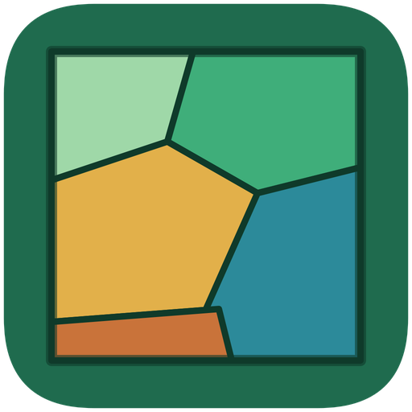

eHabitat+
============

 This work is licensed under a <a rel="license" href="http://creativecommons.org/licenses/by-sa/3.0/deed.en_US">Creative Commons Attribution-ShareAlike 3.0 Unported License</a>.

[**eHabitat+**](https://www.sciencedirect.com/science/article/pii/S157495412300119X) GRASS GIS scripts and Python library for automatic delineation of habitats within protected areas (PA) and calculation of maps of probabilities to find areas presenting similar ecological characteristics to those found in PA within the corresponding ecoregion. A habitat similarity index (HSI) is computed based on the ratio between the extent of similar areas around the PA and the PA extent, as well as some  landscape metrics and indices to characterize similar areas to PA.

**Documentation: [wiki](https://github.com/monitoreo-obsnev/eHabpy/wiki)** (installation, the desktop app for macOS,
Windows and Ubuntu, the tutorial of the Habitat Functional Types, their similarity in the ecoregion with the landscape
metrics and the THDI, the outputs and how the model works). The diagram of the whole workflow is on the
[home page of the wiki](https://github.com/monitoreo-obsnev/eHabpy/wiki#workflow).

**What's new: [changelog](#changelog)**, what each release brings, at the end of this page.

Cite eHabitat+ as https://doi.org/10.5281/zenodo.595844 (the DOI of all its versions, which leads to the last one;
the DOI of each release is on its page of Zenodo)

---

## Changelog

What each release brings, newest first. Every update of `master` with changes for users is a release (1.6, 1.6.1,
1.6.2...): a tag of GitHub with its [release](https://github.com/monitoreo-obsnev/eHabpy/releases), archived in
[Zenodo](https://doi.org/10.5281/zenodo.595844) with its own DOI. Each entry names the parts of eHabitat+
it reaches (the **Desktop app**, its **Installers**, the **HFT model**: `setup.py`, `run_hft.py` and their steps, the
**Similarity**: `similarity.py` and `thdi.R`, the **Earth Engine variables**: `get_vars_gee.py`, and the
**Documentation**), and **(fix)** marks an error that was fixed. The desktop app updates itself from `master` every
time it opens, so it has each release as soon as it is made.

### [1.6.15](https://github.com/monitoreo-obsnev/eHabpy/releases/tag/1.6.15) · 2026-11-27

- **eHabitat+**: The repository of eHabitat+ moved to [monitoreo-obsnev/eHabpy](https://github.com/monitoreo-obsnev/eHabpy) (the old address, javimarlop/eHabpy, leads there): the desktop app updates itself from it, the installers download the code from it and the documentation links to its new address.

### [1.6.14](https://github.com/monitoreo-obsnev/eHabpy/releases/tag/1.6.14) · 2026-11-26

- **Desktop app, HFT model**: The segmentation can use a number of axes of the PCA, the first N in every study area ("A number of axes" in "Axes of the PCA" of "HFT mapping", `SEGM_PCA_AXES` in `config.py`), besides the first three or those that explain a % of the variance. "See the PCA in the study area", next to it, opens a viewer of the PCA of the variables in each study area chosen: how much each variable loads on each axis (its correlation with it, in colours), the % of the variance of each axis, and how much of each variable the axes chosen take, marking those they take less than 50 % of, which the segmentation hardly sees; clicking an axis or moving the slider changes the number of axes, and "Use the first N axes" sets it. On the command line, `python3 pca_preview.py --axes 4` lists the same. A parameters file saved before these options sets them to their default (the first three axes) when loaded. The next run of the model segments again, as the code of the segmentation changed.
- **Desktop app** (fix): "Check in the study area" of "Axes of the PCA" (now "See the PCA in the study area") no longer fails with "'function' object has no attribute 'study_inputs'".

### [1.6.13](https://github.com/monitoreo-obsnev/eHabpy/releases/tag/1.6.13) · 2026-11-26

- **Desktop app, Similarity** (fix): The similarity of a scenario whose variables have NoData NaN (`float('nan')` in `processing_metadata.txt`) uses the variables of that scenario, and no longer those of `config.py`, which could be those of another scenario (e.g. 8 variables instead of its 7). If the variables of `processing_metadata.txt` cannot be read, the similarity stops and says what to correct, instead of using those of `config.py` without a warning.
- **HFT model** (fix): A variable whose NoData is infinite no longer makes `setup.py` write a `config.py` that cannot be read.

### [1.6.12](https://github.com/monitoreo-obsnev/eHabpy/releases/tag/1.6.12) · 2026-11-26

- **HFT model** (fix): A study area where a variable has the same value in every pixel (e.g. all 0) is no longer segmented on axes of the PCA without values: the segmentation stops and says which area and what to do (take the variable out of the set, or segment without PCA).
- **Desktop app, HFT model**: The segmentation can use the axes of the PCA that together explain a % of the variance (with a slider, from 50 to 100 %; "Axes of the PCA" in "HFT mapping", `SEGM_PCA_VARIANCE` in `config.py`) instead of the first three, so that what the first three leave out, e.g. a variable added that loads on the fourth axis, is also segmented. With the three by default, as before, the log of the segmentation now says how much of the variance they explain, and so do `processing_metadata.txt` and `pca_axes_<id>.csv` in the results (every axis, its % of the variance and whether it was used). Before segmenting, "Check in the study area" (next to the slider) computes the same PCA of the variables in each study area chosen and says how much the first three axes explain and how many axes each % needs; on the command line, `python3 pca_preview.py --variance 90`.

### [1.6.11](https://github.com/monitoreo-obsnev/eHabpy/releases/tag/1.6.11) · 2026-11-25

- **Desktop app, HFT model**: The parameters can be saved to a file and loaded by another user, or by you in another study area: "Save to a file…" and "Load from a file…" in "HFT mapping" keep the options of the HFT model and of the similarity, the recipe of MonitorEO and the order of the variables, without what belongs to the study area or the computer (the study area, its IDs and variables, the scenario, the GRASS database, the comparison area). Before loading, the app shows what changes, and it refuses a file with a value that is not valid without changing anything; the recipe downloads into a folder of its own for the new study area (`gee_<study area>`). Every run of the model also leaves its `parameters.yaml` in the folder of its results, and on the command line `python3 parameters.py save|show|load <file>` does the same.

### [1.6.10](https://github.com/monitoreo-obsnev/eHabpy/releases/tag/1.6.10) · 2026-11-25

- **Desktop app, HFT model**: "Input variables" lists the variables of the study area numbered in the order of the model, with the first one (it defines the pixels analysed) marked, and ↑ ↓ (or ⤒, to make it the first one) change that order without renaming the files: it is kept in `variables_order.txt` of the set, which `setup.py` follows (run again by itself, without importing the maps again). The names are shorter (without their common start) and the columns with the same value in all the variables are shown once above the table.
- **Desktop app, Earth Engine variables**: In "Download from MonitorEO", the help of the buffer of the study grid says how much it is when left empty (the buffer of the study area in "HFT mapping", e.g. "empty = 500 m"), and the field, the plan and the download warn when the buffer written is smaller than that of the model, which would work on a border without data. "Input variables" and "Download from MonitorEO" no longer show names of `config.py` (INVARS_FOLDER, SEGM_PCA, CLIP_PERCENTILE) in their labels and notes, but those of the options in "HFT mapping".
- **Desktop app**: In "From MonitorEO… > Protected areas (WDPA)", a protected area without a reported area no longer shows 0 km²: it shows the area of its polygons (marked with *) or —; "Show them on the map" (or "Map" in a row, which highlights it) draws the outlines of all those found on a map of the dialog, without making any file, to tell apart protected areas with similar names; and the file made of protected areas or administrative units gives its area in km², as the search (a burned area, in ha).
- **Earth Engine variables, Desktop app**: The plan of a download ("Show the plan", `get_vars_gee.py --dry-run`) gives the number of images of each variable with its unit and period ("2,027 images (2018-01-01 to 2021-12-31)"), warns when a variable has no images in its period and season (or, for those of the catalog of MonitorEO, very few), and ends with the size of all its files, uncompressed, by grid and in all (e.g. "about 887 MB in 18 files"); the same size is shown before a download.
- **Desktop app, HFT model**: "Input variables" and `setup.py` warn when the variables do not cover a study area to process, with the part of it they cover (inside all the variables and with data in the first one): a study area only partly covered gets HFTs only where the variables have data, and one without any data gets none.

### [1.6.9](https://github.com/monitoreo-obsnev/eHabpy/releases/tag/1.6.9) · 2026-11-24

- **Desktop app, Similarity**: The map of the page Similarity shows all the results of a run at once (Map: All, the default): the similar patches of every HFT or subclass in its colour, those at least as large as the HFT outlined, over the HFTs of the study area, each one shown or hidden from its legend, with the number of patches and hectares of each one and the HFT, kind and area of a patch when the mouse is over it. Compared with chooses the area whose results are shown (the ecoregion of the set or each comparison area), keeping the cut, pixel size and classes of the run shown when that area has them. Runs made before the GeoPackages of the patches are shown too, from their maps of the similar areas.

### [1.6.8](https://github.com/monitoreo-obsnev/eHabpy/releases/tag/1.6.8) · 2026-11-24

- **Similarity**: The patches similar to each HFT or subclass are also saved as polygons, one per patch, in a GeoPackage named after the HFT and the subclass (`similar_<id>_hft_<n>.gpkg`, `similar_<id>_hft_<n>_sub_<y>.gpkg`), with their category (similar, or at least as large as the HFT), number of pixels and area in ha, ready to use in a GIS.

### [1.6.7](https://github.com/monitoreo-obsnev/eHabpy/releases/tag/1.6.7) · 2026-11-24

- **HFT model, Similarity, Desktop app**: With the subclasses of the pixels of the HFTs, the shapefile of the HFTs of each cut has every segment split into its subclasses, with their label `hft_<n>_sub_<y>` (field `subclass`) and code (`sub_code`), so they can be used as polygons in a GIS; the similarity can compare the subclasses with the ecoregion instead of the HFTs (Classes compared, `ECOSIM_CLASSES = 'subclass'`), with their own results. The fields of the shapefile have clearer names (`hft`, `segm_cat`, `area_id`, `area_ha`, and the variables by the part of their name that differs, e.g. `NDVI_S2_p9`), explained in `park_segm_*_class_fields.csv` next to it; the shapefiles of earlier versions can still be used.

### [1.6.6](https://github.com/monitoreo-obsnev/eHabpy/releases/tag/1.6.6) · 2026-11-24

- **Desktop app, Earth Engine variables**: The recipe of the Earth Engine variables can also remove the snow by its NDSI (Snow also by its NDSI ≥, e.g. 0.4, in Sentinel-2 and Landsat): the patches of snow that the quality band misses, which raise the standard deviation of the NDMI in mountains. The options of a loaded recipe that the form does not show (such as the topographic correction) are no longer lost when it is downloaded or saved.

### [1.6.5](https://github.com/monitoreo-obsnev/eHabpy/releases/tag/1.6.5) · 2026-11-24

- **Desktop app**: The catalog of MonitorEO shows apart what is for choosing areas rather than for characterising the HFTs: the burn severity (RBR, RdNBR, and a search for dNBR, severity or fire) offers its burned area as the study area, and the RESOLVE ecoregions and biomes (ECOREGION, BIOME) are regions for the comparison area, no longer added to a recipe or its conditions (a recipe that has them asks to remove them).

### [1.6.4](https://github.com/monitoreo-obsnev/eHabpy/releases/tag/1.6.4) · 2026-11-23

- **Desktop app**: The protected areas from MonitorEO (study areas, or the comparison area of the Earth Engine variables) can also be found by their WDPA ID, the number of protectedplanet.net (several separated by commas, e.g. `389011, 389012`), besides their name.

### [1.6.3](https://github.com/monitoreo-obsnev/eHabpy/releases/tag/1.6.3) · 2026-11-22

- **HFT model**: Segmentations with tens of thousands of segments (e.g. low thresholds in `SEGM_THRESHOLDS`, for small habitats) are classified into HFTs without running out of memory: a threshold with more than 7,500 segments gets its tree, cophenetic correlation and silhouettes with memory that grows with the segments instead of their square (about 0.5 GB instead of about 200 GB with 55,000 segments, in about a minute), with the same HFTs and values as before (with `CLASS_METHOD = 'ward'`, as long as every segment has data in every variable); thresholds with fewer segments are classified as until now.

### [1.6.2](https://github.com/monitoreo-obsnev/eHabpy/releases/tag/1.6.2) · 2026-11-22

- **HFT model, Desktop app**: The pixels of each HFT can also be divided into subclasses (Subclasses of the pixels of the HFTs, `HFT_SUBCLASSES = True`), for what changes inside the segments, such as small wet meadows: as many as the variability of the HFTs of each cut gives, with nothing to choose. Each cut gets their map (GeoTIFF and plot) and their table, and the map of the results can show them over the HFTs.

### [1.6.1](https://github.com/monitoreo-obsnev/eHabpy/releases/tag/1.6.1) · 2026-11-22

- **Similarity, Desktop app**: The fit of each similarity map in its study area gives the % of the study area similar to the HFT (Study similar in the results table, `StudySim_pct`) and the % of that area that is the HFT itself (Self-fit), without the % of the HFT similar to itself (`SelfSim_pct`, no longer in `hri_results.csv`), which is set by the threshold of the HFT rather than by the fit (the threshold is the mean, or median, similarity of its own pixels, so about half of them are at or above it); `sim_fit_<id>.png` shows that diagonal in grey.
- **Similarity** (fix): The subtitle and the note of the plot of the fit in the study area (`sim_fit_<id>.png`) are no longer cut at the right edge.

### [1.6](https://github.com/monitoreo-obsnev/eHabpy/releases/tag/1.6) · 2026-11-22

- **eHabitat+**: Every update with changes for users is a new release (1.6, 1.6.1, 1.6.2...) archived in Zenodo with its own DOI, so the exact version that was used can be cited; its notes are its entries of this changelog.
- **HFT model, Desktop app**: The thresholds of the segmentation can be chosen (Segmentation thresholds, `SEGM_THRESHOLDS`, by default the nine from 0.1 to 0.9), e.g. `[0.02, 0.04, 0.06, 0.08, 0.1]` for smaller segments in very small habitats (with a smaller `MIN_SEGM_SIZE`, since no segment is smaller than the minimum size); a fixed threshold must be one of them, and the plots, tables and the app show the value of each threshold. With other thresholds than the nine of 0.1 to 0.9 the `segm_id` of a segment has 2 digits for the threshold and 7 for the segment (up to 9,999,999 segments per threshold instead of 99,999).
- **HFT model, Desktop app**: The pieces smaller than the minimum size that the segmentation leaves (cut by pixels without data or by the outline of the study area) can join the most similar larger segment within the radius (Merge small segments into, `SMALL_SEGM_MERGE = 'similar'`) instead of the most frequent one, which can be quite different from them; `'frequent'` is the default and keeps the rule used up to now.
- **HFT model, Desktop app**: The statistics of the segments are computed for all of them at once, so a segmentation with tens of thousands of segments takes minutes instead of hours, with the same statistics except in the last digits. After this update the segmentation of every study area is marked to run once more.
- **Similarity, Desktop app**: The mean and covariance of each HFT are robust by default: the Minimum Covariance Determinant (option `ECOSIM_COVARIANCE`, `'mcd'` or `'classic'`), so mixed pixels at the edges of the HFT, roads or other outliers no longer widen its covariance and inflate its similar areas.
- **Similarity, Desktop app**: Fit of each similarity map in the study area itself, as a check of its robustness: the % of the HFT similar to itself, the % of the study area similar to it and the % of that similar area that is the HFT itself (`SelfSim_pct`, `StudySim_pct`, `SelfFit_pct` in `hri_results.csv` and the results table), with the whole matrix between HFTs in `fit_matrix.csv` and the heat map `sim_fit_<id>.png`.
- **Desktop app, HFT model** (fix): After changing the input variables of the same study area, the segmentation no longer shows as up to date: it is marked to run, since setup.py imports the variables again first.
- **Desktop app**: The HFT map of the results shows the number of the HFT under the mouse, and a click on a segment opens its HFT again (the outline of the study area took the mouse over the whole area).
- **Desktop app, HFT model**: New tab HFT comparator: it puts together the tables of HFTs (`hft_means_*.csv`) of the folder `segm_optim/comparison`, which are added from the results with a button or copied by hand, and shows how similar the HFTs of other study areas, scenarios or options of the model are: a common table with a unique label (study area / scenario / ID / cut / HFT) and code for every HFT, the NMDS, the tree, the profiles, the PCA, the similarity between HFTs and sources, the most similar HFT of each other source and the radar plots (`hft_compare.R`).
- **HFT model**: The tables of HFTs have the study area, the scenario, the ID, the threshold and the cut in their names (`hft_means_<area>_<scenario>_<id>_<k>.csv`, and with `SIMIL = 3` one per cut in its folder), so that those of different runs can be put in the same folder without renaming them.
- **Desktop app, HFT model**: The minimum size of a segment can be set by hand (Minimum size of a segment, in pixels, `MIN_SEGM_SIZE`), the same in every area, instead of depending on the size of each study area (0 keeps the automatic value, the square root of its pixels).
- **Desktop app, HFT model**: While the model runs, two progress bars show the step it is in (segmentation, statistics of the segments, Moran's I and threshold, HFTs and plots) and how far the whole model has gone.
- **Desktop app, HFT model**: The cuts of the classification tree can be chosen (`SIMIL_CUTS`, % of the height of the tree, e.g. 15, 40, 60; by default 10, 25, 50, 75 and 90), before or after a run: changing them and running again from "plots" repeats only the classification (seconds, without segmenting again) and writes a folder p15, p40, p60 for each cut.
- **Desktop app, HFT model**: With a fixed segmentation threshold (e.g. 0.1) the segmentation stops at that threshold and only it is converted, summarised and shown, instead of calculating the nine thresholds, which saves time (the segments are the same as before). The plots and tables that compare thresholds are not made then.
- **Desktop app, Earth Engine variables**: The annual precipitation of OpenLandMap (about 1 km, a climatology of 2007–2018 that averages WorldClim, CHELSA Climate, IMERG and SM2RAIN-ASCAT) is ready to use in Other collection or image… (Source "Ready to use"), and Add from the catalog… offers it with the precipitation of the catalog (PRECIP and BIO12). Any other image or collection can combine several of its bands into one, their sum (e.g. 12 monthly bands into the annual total) or their mean, which needs MonitorEO 0.3.50 or later (Update MonitorEO).
- **Documentation**: The tutorial says that the topographic wetness index is in the catalog of MonitorEO (TWI of MERIT Hydro, 90 m, a fixed layer), instead of that it is not in Earth Engine.
- **HFT model, Desktop app**: The silhouette width of the segments between the HFTs (Rousseeuw, 1987; from -1 to 1, how much closer each segment is to its HFT than to the next one): its mean weighted by area for each cut in `r2_<id>_cuts.csv` and in the labels of `r2_<id>_hfts.png` and `hft_tree_<id>_<k>.png`, for each number of HFTs in `r2_<id>_hfts.csv`, for each HFT in `hft_means_<id>_<k>.csv`, for each segment in the shapefile of the HFTs, and a silhouette plot of each cut (`silhouette_<id>_<k>_<cut>_segms.png`, with its `.csv`), also shown in Results.
- **Desktop app, Earth Engine variables**: The coefficient of variation (`cv`, %) as a metric of the images of each pixel and between years, with two shortcuts in Add from the catalog, the seasonality (seasonal CV) and the interannual variability (CV of the annual means), and a warning for variables whose mean can be near 0 or negative (temperatures in °C, NDWI, LSWI, NDSI, NBR). It needs MonitorEO 0.3.46 or later (Update MonitorEO).
- **Desktop app** (fix): A recipe with a metric between years other than mean, median, min or max (e.g. `std` or `p90`) no longer loses it when saved from the app, which made the download use the mean without warning; Between years now also offers std, the percentiles and the CV.
- **Desktop app, Earth Engine variables**: Other collection or image… searches the Earth Engine data catalog by words in English, optionally only the datasets over the study area and in the period of the recipe, and reads the bands of the one chosen (MonitorEO 0.3.47 or later).
- **Desktop app**: **From MonitorEO…**, next to the file of the study areas and to the comparison area, makes them with MonitorEO in Earth Engine: the burned area of a fire, delimited from the dNBR, the RBR or the RdNBR of a period before and a period after it (Sentinel-2, Landsat or MODIS), and the unburned ring around it (a band of the width you choose outside the burned area, e.g. to compare the HFTs of the burned area with); protected areas of WDPA (or only its Ramsar sites) and administrative units of FAO GAUL 2025, found by their name. Each one is a GeoPackage in `segm_optim/areas`, with an ID and a name for each area, a record of how it was made and its references, and can be used as study areas or as the comparison area.
- **Desktop app** (fix): Add from the catalog no longer offers variables that made the download fail: the RBR and the RdNBR, which compare a period before and a period after a fire, lead to the burned area instead; the snow and cloud frequencies (SCF, CF) take only the metric mean; and the fixed layers (elevation, slope and the BIO variables of WorldClim) have no metric or temporal aggregation to choose. Its list of sensors has all those of the catalog (also Copernicus, ERA5-Land, TerraClimate, CHIRPS and WorldClim).
- **Desktop app**: The recipe is checked with MonitorEO while it is edited or loaded: a variable or condition that would make the download fail is marked with the reason, and the download or the plan does not start until it is fixed.
- **Desktop app**: Conditions on variables in the recipe keep only the pixels where variables of the catalog are within some values, e.g. above 1500 m of elevation or with less than 600 mm of annual precipitation, together with the land cover mask.
- **Desktop app, Earth Engine variables**: The true colour of the study area (red, green and blue reflectance) from the same images and pixels as a variable of the recipe, with its period, season, pixel filters and conditions and the metric of your choice, is downloaded with the variables to `inVars/<folder>/rgb` (`rgb: {index: NDVI, sensor: Sentinel-2, metric: median}` in the recipe) and shown on the map of Input variables.
- **Desktop app** (fix): Dialogs taller than the window, such as the catalog of MonitorEO on a small screen, scroll instead of leaving their buttons out of reach.
- **Desktop app** (fix): The date of the version shows also in a copy that was updated before the app kept it: the app reads it from GitHub when it is missing.
- **Documentation**: Every release in Zenodo has the same title, "eHabitat+ model: mapping habitat functional types and similar areas", its author with ORCID and the licence of eHabitat+, CC BY-SA 3.0 (`.zenodo.json`), instead of the name of the release, the authors of GitHub and CC BY 4.0.
- **Documentation**: The README and the wiki cite eHabitat+ with the DOI of all its versions, https://doi.org/10.5281/zenodo.595844, which leads to the last one, instead of the DOI of version 1.3.

### [1.5](https://github.com/monitoreo-obsnev/eHabpy/releases/tag/1.5) · 2026-11-14

- **Desktop app**: The version, at the bottom of the side bar, shows the date its commit was published next to the commit and the branch (e.g. `def0624 · master · 2026-11-14`).
- **Documentation**: The changelog of eHabitat+ is the section Changelog at the end of the README, which every change updates, instead of `changelog.txt`.
- **Desktop app**: In Download from MonitorEO, the button **GEE Community Catalog…** adds to the recipe any of the 1,068 images and collections of images of the [GEE Community Catalog](https://gee-community-catalog.org), found by theme or by words of their title, ID, provider or tags. **Read** shows the bands of any ID of Earth Engine, whether it is a fixed image or a collection with dates, and the scale, offset and unit of the band when its record gives them; a collection can have its own period, and the unit of the values goes into the recipe.
- **Desktop app** (fix): Editing a variable of another collection or image of Earth Engine keeps its own season, pixel filters and conditions, which were lost.
- **Desktop app, Earth Engine variables**: A land cover mask leaves out of every variable the pixels of some land covers (water, trees, grassland, wetlands, cropland, shrubland, built-up, bare ground, snow and ice) after a land cover map and a year of your choice: ESA WorldCover (2020, 2021), Dynamic World (every year since 2016), CORINE Land Cover (Europe, 1990 to 2018) or MODIS MCD12Q1 (2001 to 2025). In the recipe it is `where: {landcover: CORINE, year: 2018, exclude: [water, built]}`; the classes of ESA WorldCover 2021 of before (`exclude_landcover`) still work.
- **HFT model**: `hft_means_<id>_<k>.csv` and `hft_stats_<id>_<k>.csv` have the pixel size of the variables (column `resolution`): HFTs made with other pixel sizes are not directly comparable.
- **HFT model, Desktop app**: Tables of the HFTs to compare study areas, in the folder of the scenario: `hft_means_<id>_<k>.csv`, the mean of the pixels of every HFT in each variable, and `hft_stats_<id>_<k>.csv`, their n, mean, sd, quartiles, minimum and maximum, in the original units, so that the tables of several study areas can be joined for an NMDS or a tree of all their HFTs (example in the wiki). The app shows `hft_means` in Results.
- **Desktop app**: Every map has the basemap Sentinel-2 cloudless 2023 (EOX).
- **HFT model, Similarity**: Every plot comes with a `.csv` of the same name with the data it draws.
- **Similarity** (fix): Global ecoregion files (e.g. all of RESOLVE) are read only near the grid, as they could not be reprojected far from it; ecoregions without an ID field get the same IDs in the maps and the tables, and `--id` keeps the other IDs of a folder of results.
- **Similarity, Earth Engine variables**: The HFTs can be compared with a comparison area of your own, inside or outside the study area (`ECOSIM_AREA`, `--area`): a folder of variables with the same names, downloaded with its own grid, and with the study area at its pixel when the area does not contain it.
- **Desktop app**: New page Similarity: the HFTs of a scenario and cut, the pixel size, the options, the run with its log, and the results (THDI, landscape metrics, the map of the similarity and of the similar areas of every HFT, plots).
- **Similarity**: `thdi.R` takes the results of `similarity.py` as arguments (`--hri`, `--hfts`, `--ecoregions`, `--marine`, `--out`), with the same indices, ecoregions in any CRS and NA values.
- **Similarity** (fix): Compared with `ehab_optim.py`, the pixels outside the ecoregion have no data instead of a similarity, the HFT and the ecoregion pixels are on the same grid, no random noise is added to the values of the HFTs (a variable constant in an HFT is left out of the distance, and the run says which), and the values of an HFT are no longer inherited from the previous one.
- **Similarity**: The similarity can use a coarser pixel (`ECOSIM_RESOLUTION`, a multiple of that of the ecoregion variables, aggregated by their mean), and the mean and covariance of every HFT come from the pixels of the similarity grid it covers, so that the HFT and the ecoregion are measured with the same pixel and product.
- **Similarity**: New `segm_optim/similarity.py`, after `run_hft.py`, which replaces `pas/subpas_loop_segm_optim.py` and `ehab_optim.py`: it compares every HFT of a cut with every pixel of its ecoregion (the same variables at the ecoregion scale), writes the similarity map of every HFT, the map of its similar areas and `hri_results.csv` with the landscape metrics of eHabitat+, and runs `thdi.R` and `similarity_plots.R`. New options `ECOSIM_*` in `config.py`.
- **HFT model** (fix): On Windows, `setup.py` and `segmentation_pca_par.py` set `GISBASE` and `HOME` as GRASS GIS needs them: its modules missed their colour tables and the vector modules failed.
- **Installers**: The installer for Windows works on a new Windows 11 (the Visual C++ runtime, short paths for the packages, terra from CRAN and OpenMP for GRASS GIS 8.5). GRASS GIS 8.5 of conda-forge for Windows cannot open databases yet, so the HFT model runs in WSL2 with the installer for Ubuntu, where the app opens the web browser and the folders of Windows.
- **Desktop app**: The study areas to process (the IDs of `palist.csv`) are chosen in HFT mapping, with their names and areas, and the results of each one are shown with its outline highlighted on the map.
- **Installers**: Installer for Ubuntu LTS and other Linux distributions on x86_64 (`app/installer/linux/install.sh`), without sudo, with entries in the applications menu and on the Desktop; without a toolkit for its window, the app opens in the web browser.
- **Desktop app**: The app updates itself from GitHub every time it opens, keeping the files you changed (`config.py`, `gee_vars.yaml`, ...), and updates its environment when `environment.yml` changes; a button checks for updates and a switch turns them off (or `EHAB_NO_UPDATE=1`).
- **Documentation**: The documentation moved from the README to the [wiki](https://github.com/monitoreo-obsnev/eHabpy/wiki), with a page for the desktop app.
- **Earth Engine variables**: Without an Earth Engine project, `get_vars_gee.py` uses the shared account of MonitorEO, which only downloads directly (not through Google Drive).
- **HFT model**: `moranvar_plots.R` writes the colour of every HFT of each cut to `hft_colours_<id>_<k>[_<cut>].csv`, for the map of the desktop app.
- **Desktop app, Installers**: New desktop app (`app/`): the input variables at the plot and ecoregion scales with their checks, the download of variables from MonitorEO, every option of `config.py` with its default, the runs of `setup.py` and `run_hft.py` with their log, and the plots, tables and an interactive map of the HFTs of each cut. Its installers for macOS and Windows create its environment with micromamba, without administrator rights, with a shortcut on the Desktop.
- **HFT model** (fix): R no longer prints "was not checked for suspicious field assignments" when terra loads (`environment.yml` adds r-codetools), and the radar plots no longer print "Ignoring unknown labels: size".
- **HFT model** (fix): `moranvar_plots.R` no longer fails with "Write error" when it writes the shapefile of the HFTs with variable names that only differ at the end.
- **Earth Engine variables**: `get_vars_gee.py` uses the Python package of [MonitorEO](https://github.com/monitoreo-obsnev/monitoreo) instead of its own copy, so it computes the variables as the QGIS plugin, the R package and the MCP server of MonitorEO do; every run installs its last version from GitHub (`--no-update` skips it).

### [1.4](https://github.com/monitoreo-obsnev/eHabpy/releases/tag/1.4) · 2026-10-27

- **Earth Engine variables**: New `segm_optim/get_vars_gee.py` and its recipe `gee_vars.yaml`: it downloads the input variables from Google Earth Engine with the catalog of MonitorEO, for the study area with a fine pixel (`inVars/<folder>`) and for the RESOLVE ecoregions it touches with a coarser one (`inVars/<folder>/ecoregion`): variables of the catalog, other collections or fixed images (e.g. a DEM with `terrain: slope`), with their period, season, pixel filters (clouds, water, snow, aerosols) and one or several metrics. Only the files whose recipe or grid changed are downloaded again, and large grids can go through Google Drive (`drive: true`).
- **HFT model**: New `CLIP_PERCENTILE` option in `config.py` (default 0): every layer of the segmentation and every variable of the classification is clipped to its percentiles, so that a few extreme pixels do not set how much each one weighs; the statistics, the threshold selection and the plots keep the original values.
- **HFT model**: New plot `cor_<id>_vars.png`: the correlation between every pair of variables in the pixels of the segments, to see which variables repeat the same gradient.
- **HFT model**: New `INVARS_FOLDER` option in `config.py`: a subfolder of `inVars` with another set of variables, to try it without moving files; `setup.py` imports it with the name of the folder in the names of the maps, and an empty `SCENARIO` takes its name, so that every set of variables has its own results.
- **HFT model**: `moranvar_plots.R` no longer draws the NMDS of the segments, whose r² of the variables was easily misread as their importance: the eta² of the heatmap gives it, and the PCA biplot shows how the HFTs are distributed.
- **HFT model**: New tree of the HFTs of the cuts with `SIMIL = 3` (`hft_tree_<id>_<k>.png` and `.csv`): which HFTs of a cut belong to the same HFT in the broader cuts and how each one splits in the finer ones.
- **HFT model**: `moranvar_plots.R` suggests a cut, the one whose number of HFTs is closest to the bend of the R² curve of the selected threshold (beyond it, more HFTs add little explained variance); its files carry `_optim` after the name of the cut and its figures say "suggested".
- **HFT model**: Hierarchical colours of the HFTs with `SIMIL = 3` ("tree colors" in HCL): every HFT of the broadest cut gets a part of the colour circle and the HFTs inside it share it out, distinguishable with up to about 10 HFTs, also with colour blindness; the legends follow the order of the dendrogram.
- **HFT model**: With `SIMIL = 3` the tree is also cut at 10 and 90 % of its height (`p10` and `p90`, besides `p25`, `p50` and `p75`).
- **HFT model**: New `CLASS_METHOD` option in `config.py`: `ward_area` (default), Ward's method weighted by the pixels of each segment, which gave HFTs with a higher R² and silhouette than the original method in the Guajares data; `ward_area_kmeans`, followed by k-means; or `ward`, the original.
- **HFT model**: New plot `r2_<id>_hfts.png`: the variance of the pixel values explained by the HFTs when the tree of every threshold is cut into 2 to 30 or more HFTs; the plot of the thresholds shows the score of the method and the threshold selected.
- **HFT model**: New `THRESHOLD_METHOD`, `THRESHOLD_ALPHA` and `MORAN_NEIGHBOURS` options in `config.py`: `moranvar.py` chooses the segmentation threshold with the F-function of Johnson et al. (2015) (`f`, the default), the Global Score of Espindola et al. (2006) (`gs`, `gs_fixed`), the original crossing of the curves (`crossing`, `crossing_first`) or a fixed threshold, and writes the score of every threshold to `csv/<id>_threshold.csv`.
- **HFT model** (fix): `ehab_segm_core.py` no longer adds a random noise to the pixel values before computing the statistics of the segments, which raised their means and their variance.
- **HFT model**: New `SEGM_PCA` option in `config.py` (default `True`): with `False` the variables themselves are segmented instead of the first three axes of their PCA.
- **HFT model**: Scenarios: the `SCENARIO` option of `config.py` writes the results to `results/<STUDY_AREA>/<SCENARIO>`; `run_hft.py` shows it, lets you change it (`--scenario`) and warns when the scenario has results made with other options.
- **Documentation**: Tutorial of the HFT module, the interpretation of all the outputs and how the model works.
- **HFT model**: `moranvar_plots.R` moves the previous results of the study area to `results/<STUDY_AREA>_previous`, so that the files of runs with different options are not mixed; `moranvar.py` stops with an error when `moranvar_plots.R` fails.
- **HFT model**: `setup.py` stops when the variables have a geographic CRS, and imports again the files that changed since it imported them.
- **HFT model** (fix): The statistics of the segments are computed in double precision without rounding, the same on every run, and the pixel offsets are rounded instead of truncated.
- **HFT model** (fix): The working region and the segments are aligned with the grid of the first variable, so that the masks of the segments fall exactly on its pixels.
- **HFT model** (fix): `PA_BUFFER` is in map units, as documented: it grew the region by that number of pixels (5 km instead of 500 m with 10 m pixels).
- **HFT model**: `segmentation_pca_par.py` resumes an interrupted run only when its inputs did not change, and does nothing when it is up to date; `FORCE_RESTART` is now `False` and only forces a new segmentation.
- **HFT model** (fix): `get_mean_median_var.py` and `moranvar.py` can run again without duplicating the rows of their tables.
- **HFT model**: New `run_hft.py`: it runs only the steps that are out of date with `config.py`, `palist.csv`, the input files and the code, and those after them (`--status` says what would run and why, `--from` repeats from a step); a script run by hand says what to run first.
- **HFT model**: New plots of the HFTs: boxplots of the values of all the pixels of every HFT in each variable, heatmaps of their profiles (the median of every HFT in each variable, with the variables ordered by the share of their variance explained by the HFTs, eta²) and PCA biplots with the HFTs and the variables.
- **HFT model**: The HFT maps are drawn with ggplot2 at 300 dpi, with the legend outside the map, coordinates, the outline of the study area in black and a title with the study area, threshold, cut and number of HFTs; the radar plots have the same title, every HFT in numeric order with the colours of the map, and the names of the variables shortened and wrapped instead of cut.
- **HFT model** (fix): `ehab_segm_core.py` no longer leaves out of the HFTs the segments that start in the first row or column of the variables (19 % of the area in the Guajares data).
- **HFT model**: The segments smaller than `minarea` are merged in memory, much faster and without "Too many open files", with the segments within `SMALL_SEGM_RADIUS` pixels (new option, default 5) in repeated passes, and then with the nearest large segment, so that none is left.
- **HFT model**: The results of every study area are saved in `results/<STUDY_AREA>`, and `FORCE_RESTART` only removes those of the study area processed.
- **HFT model**: The valid pixels are those with data in the first variable of `ENV_VARS0` (before, those of `precip` of 0 or more), and the pixel size comes from `RESOLUTION` in `config.py` (before, 10 m).
- **HFT model**: New `segm_optim/setup.py`: it creates the GRASS GIS project from the GeoTIFFs of `inVars` and the study area of `pa/`, writes `palist.csv` and fills the required options of `config.py` from the data.
- **HFT model**: New `SIMIL` option in `config.py`: `SIMIL = 3` cuts the tree of the HFTs at 25, 50 and 75 % of its height, each cut in its folder and with its name in the files, and `processing_metadata.txt` records the options of the run.
- **HFT model** (fix): The optimal threshold is interpolated on the values of the thresholds and is always one of those tested, and `overall_optim_thresholds.csv` keeps one row per study area.
- **HFT model** (fix): `segmentation_pca_par.py` starts from the PERMANENT mapset, creates its output folders and stops with an error instead of hanging when a command of GRASS GIS fails.
- **HFT model** (fix): Resuming with `FORCE_RESTART = False` first removes the leftovers of an interrupted study area.
- **HFT model** (fix): The IDs of the segments no longer collide between thresholds or study areas, and are the same on every run.
- **eHabitat+**: eHabitat+ runs with Python 3.10 to 3.12, GRASS GIS 8, GDAL 3, NumPy up to 2.2 and R 4 with sf instead of rgdal (see `MODERNIZATION.md`).

### [1.3](https://github.com/monitoreo-obsnev/eHabpy/releases/tag/1.3) · 2021-11-03

- **Similarity**: New habitat diversity and irreplaceability modules and indices.

### [1.2](https://github.com/monitoreo-obsnev/eHabpy/releases/tag/1.2) · 2021-11-02

- **Similarity**: New script for computing the THDI, the habitat diversity and irreplaceability indices.
- **Similarity**: New script that finds the landscape patches similar to the reference HFTs with their median values.
- **HFT model**: New script that finds the optimal segmentation threshold and the final HFTs with the median values.
- **HFT model**: New options in `moranvar_plots.R`.
- **HFT model**: A fixed seed map for each protected area in the first segmentation step, so that the results are the same with different versions of GRASS GIS.
- **HFT model**: The sub-areas of the protected areas are processed by themselves.
- **HFT model**: The dissolve operation is done in Python.
- **Similarity**: New column names and a new column in the results of the similarity (`hriresults`).
- **Similarity** (fix): The similarity indices are right when a mask is used.
- **Documentation**: Every script is documented, and the README has installation instructions for each operating system and a tutorial.

### [1.1](https://github.com/monitoreo-obsnev/eHabpy/releases/tag/1.1) · 2016-05-23

- **eHabitat+**: Enhanced segmentation and similarity maps for DOPA, the Digital Observatory for Protected Areas.

### [1.0](https://github.com/monitoreo-obsnev/eHabpy/releases/tag/1.0) · 2014-06-20

- **eHabitat+**: First release.
