eHabitat+
============

<a rel="license" href="http://creativecommons.org/licenses/by-sa/3.0/deed.en_US"></a><br />This work is licensed under a <a rel="license" href="http://creativecommons.org/licenses/by-sa/3.0/deed.en_US">Creative Commons Attribution-ShareAlike 3.0 Unported License</a>.

[](https://doi.org/10.5281/zenodo.5643271)

[**eHabitat+**](https://www.sciencedirect.com/science/article/pii/S157495412300119X) GRASS GIS scripts and Python library for automatic delineation of habitats within protected areas (PA) and calculation of maps of probabilities to find areas presenting similar ecological characteristics to those found in PA within the corresponding ecoregion. A habitat similarity index (HSI) is computed based on the ratio between the extent of similar areas around the PA and the PA extent, as well as some  landscape metrics and indices to characterize similar areas to PA.

## Contents

- [OS setup](#os-setup)
- [Running](#running) (quick start)
- [Extended tutorial: Habitat Functional Types (HFTs)](#extended-tutorial-habitat-functional-types-hfts)
- [Interpreting the outputs](#interpreting-the-outputs)
- [Annex: how the HFT model works](#annex-how-the-hft-model-works)

## OS setup

The recommended way to get the full geospatial stack (GDAL, GRASS, R and all
Python packages) is **conda / mamba**.

> **Windows users:** GRASS GIS is not available from conda-forge for Windows,
> so the scripts cannot find the `grass` Python package in a native Windows
> conda environment (`ModuleNotFoundError: No module named 'grass'`).
> **Install WSL2 first** (see [Windows: WSL2 setup](#windows-wsl2-setup) below)
> and then follow the Linux instructions from inside the Ubuntu terminal.

### Linux / macOS

You need to install [Anaconda](https://www.anaconda.com/download) (or
[Miniforge](https://github.com/conda-forge/miniforge)) in your system.

```
conda env create -f environment.yml
```

### Windows: WSL2 setup

WSL2 runs a real Linux (Ubuntu) inside Windows 10 (version 2004+) / 11, so the
Linux environment (including GRASS GIS) works unchanged.

1. Open **PowerShell as Administrator**, install WSL2 with Ubuntu and restart
   the computer when asked:

   ```
   wsl --install -d Ubuntu
   ```

2. Open **Ubuntu** from the Start menu and create your Linux user and password.
   All the following commands are run in this Ubuntu terminal, not in
   PowerShell.

3. Install Miniforge (conda) **inside Ubuntu** (a Windows Anaconda install is
   not visible from WSL), accept the defaults, and close and reopen the
   terminal:

   ```
   wget https://github.com/conda-forge/miniforge/releases/latest/download/Miniforge3-Linux-x86_64.sh
   bash Miniforge3-Linux-x86_64.sh
   ```

4. Get the code into your Linux home folder, either cloning the repository or
   copying an existing Windows folder (Windows drives are under `/mnt/c`,
   `/mnt/d`, ...). Do **not** use `sudo` for `git clone`, `cp` or `conda`:
   files created with `sudo` belong to `root` and you cannot edit them later.

   ```
   sudo apt update && sudo apt install -y git
   git clone https://github.com/javimarlop/eHabpy.git ~/eHabpy
   # or: cp -r /mnt/c/Users/<your_windows_user>/Documents/eHabpy ~/eHabpy
   cd ~/eHabpy
   conda env create -f environment.yml
   ```

5. Keep the code, input data and GRASS database inside the Linux file system
   (e.g. `~/eHabpy`, `~/grassdata`): working on `/mnt/c/...` is much slower.
   The GRASS database is just an empty folder that will hold your GRASS
   projects; it does not exist until you create it:

   ```
   mkdir -p ~/grassdata
   ```

   This is the folder `GRASSDB` in `config.py` points to (`'~/grassdata'`).
   Do not confuse it with the GRASS *installation* folder printed by
   `grass --config path` (e.g. `~/miniforge3/envs/ehabpy/lib/grass85`), which
   the scripts find by themselves.

6. To open these files from Windows (e.g. to copy input data or to open the
   results in QGIS), run `explorer.exe .` in the Ubuntu terminal from inside
   `~/eHabpy`, or browse to `\\wsl$\Ubuntu\home\<your_linux_user>`.
   Do not use the copy under `\\wsl$\Ubuntu\mnt\wslg\distro\...`: it is a
   read-only view of the same files used internally by WSL, and there is no
   need to remount it read-write or change its owner with `chown`.
   On Windows 11 the GRASS GIS GUI also runs from Ubuntu with `grass`.

**"Permission denied" or "Read-only file system" when creating or editing
files:** check with `pwd` that you are working in
`/home/<your_linux_user>/eHabpy` and not under `/mnt/wslg/distro/...`. If
`ls -l ~` shows `root` as the owner of `eHabpy` (something was run with
`sudo`), take ownership back with (the same for `~/grassdata` if needed):

```
sudo chown -R $USER:$USER ~/eHabpy
```

From here on, follow the same steps as Linux users.

### Manual install

Alternatively, install the pieces yourself:

- **GRASS GIS 8** (8.3+) — from your distribution's packages, from
  https://grass.osgeo.org/download/ , or `conda install -c conda-forge grass`.
- **GDAL 3** command-line utilities and Python bindings (`osgeo`).
- **Python 3.10–3.12** packages (see `requirements.txt`):
  `pip install -r requirements.txt`
  (numpy, scipy, joblib, tqdm, geopandas, libpysal, esda; GDAL via conda/system).
- **R 4.x** with: `sf`, `terra`, `vegan`, `ade4`, `ggplot2`, `reshape2`,
  `RColorBrewer`.

### Before running

Open the terminal (the Ubuntu terminal on Windows), change to your
`segm_optim` folder using `cd` and activate the environment:

```
conda activate ehabpy
```

The scripts find the GRASS GIS *installation* by themselves. Only if they fail
with `No module named 'grass'`, also run (this is not your GRASS database):

```
export GISBASE=$(grass --config path)
export PYTHONPATH=$GISBASE/etc/python:$PYTHONPATH
```

## Running

This is the short version. The
[extended tutorial](#extended-tutorial-habitat-functional-types-hfts) explains
every step, option and output of the HFT module in detail.

1. Copy all input variables (GeoTIFF, all with the same CRS and pixel size)
   to an `inVars` folder next to `segm_optim` (`../inVars` seen from
   `segm_optim`). The map name of each variable is its file name
   (`precip.tif` → `precip`).

2. Copy the vector file of the study area (`.gpkg`, `.shp` or `.geojson`) to
   the `segm_optim/pa` folder. Its file name is also the name of the GRASS
   project and of the study area map (`pa/guajares.gpkg` → `guajares`), so
   rename the file if you want another name.

3. From the `segm_optim` folder run the setup script:

   ```
   python3 setup.py
   ```

   It creates the GRASS GIS project (called *location* before GRASS 8.4)
   named after the study area in the GRASS database folder `GRASSDB` of
   `config.py` (by default `~/grassdata`), with the CRS of the variables,
   imports the variables and the study area into its `PERMANENT` mapset,
   writes `palist.csv` with all the IDs of the study area and fills the
   required options of `config.py` (`GRASSDB`, `GRASSLOC`, `ENV_VARS0`,
   `STUDY_AREA`, `COL_ID`, `RESOLUTION` and `ENV_VARS`) from the data. Use
   another GRASS database folder with, e.g.:

   ```
   python3 setup.py --grassdb ~/grassdata
   ```

   `python3 setup.py --help` lists the other options: `--study-area` when
   there are several vector files in `pa`, `--col-id` for the column with the
   IDs of the study areas (default `cat`, one ID per polygon) and
   `--overwrite` to import all the maps again. Running it again only imports
   what is not in the project yet or whose file changed since it was imported,
   and keeps an existing `palist.csv`. If you were given a ready-made GRASS project, copy its whole
   folder into your GRASS database (e.g. `~/grassdata/guajares`): it is used
   when its name is that of the study area file.

4. Edit `palist.csv` to process only some of the IDs, and check the other
   options in `config.py` (`PA_BUFFER`, `SMALL_SEGM_RADIUS`,
   `THRESHOLD_METHOD`, `SIMIL`, `STAT_AGG`, ...). The output
   folders of `segm_optim` (`csv`, `shp`, `tiffs`, `results`) are created
   automatically.

5. The results of each study area (HFT maps and shapefiles, radar plots,
   boxplots of the pixel values of each variable by HFT, heatmaps of the HFT
   profiles, PCA biplots of the HFTs and the variables, the variance of the
   variables explained by the HFTs, the other plots,
   `overall_optim_thresholds.csv` and `processing_metadata.txt`) are saved in
   a folder of their study area and **scenario** (`SCENARIO` in `config.py`,
   `base` by default), `results/<study area>/<scenario>` (e.g.
   `results/guajares/base`), so that the results of different options can be
   kept apart. They are kept when another study area or scenario is
   processed. When the same scenario is processed again, its previous results
   are moved to `results/<study area>/<scenario>_previous`. The intermediate
   folders `csv`, `shp` and `tiffs` only hold the last run.


### Habitat Functional Types (HFTs) (_segm_optim_ folder)

```
python3 run_hft.py --status # shows which steps are needed and why
python3 run_hft.py          # asks the scenario name, then runs them in order
```

`run_hft.py` runs only the steps that are out of date with `config.py`,
`palist.csv` and the input data, so after changing an option you just run it
again. Before starting it shows the scenario and lets you change it (or use
`--scenario NAME` to set it without being asked). The steps can also be run
one by one; each one stops with a message
saying what to run first if a step before it is out of date:

```
ulimit -n 8192
export PYTHONNOUSERSITE=1 # ignore Python packages installed in ~/.local

python3 segmentation_pca_par.py # it uses parallel processing

python3 # opens a python environment
from get_mean_median_var import * 
run_batch_all()
exit()

python3 moranvar.py    # calls Rscript moranvar_plots.R at the end
```

### HFTs similarity and landscape metrics (to be tested under the new environment)

```
python3 subpas_loop_segm_optim.py # move to 'pas' folder

python3 # opens a python environment
from ehab_optim import * # alternative: from ehab_optim_median import *
run_batch() # it runs using all available processors in parallel
exit()

Rscript thdi.R
```

## Extended tutorial: Habitat Functional Types (HFTs)

A **Habitat Functional Type (HFT)** is a type of landscape patch with
homogeneous environmental conditions, as described by the input variables
(vegetation indices, topography, climate, ...). The HFT module of eHabitat+
(`segm_optim` folder):

1. divides each study area, plus a buffer around it, into patches of similar
   conditions (**segments**) at nine levels of detail (segmentation
   **thresholds** 0.1 to 0.9);
2. selects the threshold that best balances the homogeneity inside the
   segments and the differences between neighbouring segments;
3. groups the segments of that threshold into HFTs with a hierarchical
   classification;
4. maps the HFTs and describes them with several plots.

This tutorial covers the HFT module only. The similarity module (`pas`
folder, `ehab_optim.py`) will be documented later.

The whole module is two commands, run from the `segm_optim` folder with the
environment activated:

```
python3 setup.py     # once per study area: GRASS project, config.py and palist.csv
python3 run_hft.py   # every step that is needed, in order
```

`run_hft.py` runs these steps, which can also be run one by one:

```
python3 segmentation_pca_par.py  # segments at 9 thresholds
python3 get_mean_median_var.py   # statistics of every segment
python3 moranvar.py              # Moran's I, variance and threshold, then runs
                                 # moranvar_plots.R: HFTs and plots
```

Every step records what it was run with (`run_state.json`), so you never have
to work out which scripts to run again: after changing an option or an input
file, run `python3 run_hft.py` and it runs only the steps affected by the
change and the steps after them. `python3 run_hft.py --status` shows what it
would run and why, without running anything.

The [workflow diagram](#a1-workflow-diagram) of the annex shows how the steps
are connected and which files each one reads and writes.

> **Names in the code.** eHabitat was first written for protected areas of the
> WDPA, so in the scripts and file names an area ID is often called `park`,
> `pa` or `wdpaid`, and the threshold index `k` (1 to 9) is sometimes called
> `ecoregion`. They mean the same as *area ID* and *threshold index* in this
> tutorial.

### Folder layout

```
eHabpy/
├── inVars/                        <- your input variables (GeoTIFF)
└── segm_optim/                    <- run every command from here
    ├── config.py                  options of the model
    ├── setup.py                   step 3
    ├── palist.csv                 IDs to process (written by setup.py, step 5)
    ├── run_hft.py                 step 6: runs the steps 7 to 9 that are needed
    ├── segmentation_pca_par.py    step 7
    ├── get_mean_median_var.py     step 8 (uses ehab_segm_core.py)
    ├── moranvar.py                step 9 (runs moranvar_plots.R, which uses CreateRadialPlot.R)
    ├── hft_state.py               records what each step was run with
    ├── run_state.json             that record (written by the scripts)
    ├── pa/                        <- the vector file of your study area
    ├── csv/  shp/  tiffs/         intermediate files (only of the last study area processed)
    └── results/<STUDY_AREA>/      final results, one folder per study area
        ├── <SCENARIO>/            one folder per scenario (base by default)
        └── <SCENARIO>_previous/   results of the run of the scenario before the last one

~/grassdata/                       GRASS database (GRASSDB in config.py)
└── <STUDY_AREA>/                  GRASS project created by setup.py
    ├── PERMANENT/                 imported variables and study area
    └── m1, m2, ...                temporary mapsets of the parallel workers (removed when done)
```

### Step 1. Prepare the input data

#### Environmental variables (`inVars`)

Each variable is one GeoTIFF file in the `inVars` folder (next to
`segm_optim`). Any continuous variable that describes the environment can be
used: spectral indices (NDVI, NDWI, ...), topography (slope, TWI, ...),
climate (temperature, precipitation, ...), soil properties, etc.
The variables must:

- have **the same CRS and the same square pixel size** (`setup.py` stops
  otherwise);
- be in a **projected CRS in metres** (e.g. UTM); `setup.py` stops with a
  geographic CRS (longitude and latitude in degrees). `RESOLUTION` and
  `PA_BUFFER` are in map units, and in degrees the pixels are neither square
  on the ground nor of the same area everywhere;
- have a **NoData value** set in the file for the pixels without data. Without
  it every pixel counts as data (e.g. `-9999` or `0` in the sea), and
  `setup.py` warns about it;
- be on **aligned grids**: same pixel size and pixel edges at the same
  coordinates, ideally with the same extent. The model works on the grid of
  the first variable, and the others are read pixel by pixel on that grid.
  Only the first band is used;
- **cover the study area plus `PA_BUFFER`** on every side;
- be **at least 3**: the segmentation uses the first three principal
  components of the variables.

A simple way to get identical grids is to warp every variable with the same
CRS, pixel size and extent (with extent coordinates that are multiples of the
pixel size), for example:

```
gdalwarp -t_srs EPSG:32630 -tr 10 10 -te 430000 4070000 460000 4090000 \
         -r bilinear -dstnodata -9999 -co COMPRESS=DEFLATE slope_raw.tif ../inVars/2_slope.tif
```

Things to keep in mind when preparing them:

- **The first variable defines the analysed pixels.** Pixels where it is
  NoData are left out of the segmentation and therefore of the HFTs. To leave
  out water, urban areas, crops, etc., set them to NoData in the first
  variable (better in all of them, as in the Guajares example, whose file
  names end in `sinAguaUrbanoCultivos`: without water, urban areas and crops).
- **Order of the variables.** The first time `setup.py` runs, the variables
  are taken in alphabetical order of their file names (afterwards it keeps the
  order of `ENV_VARS` in `config.py`). A numeric prefix (`1_ndvi.tif`,
  `2_slope.tif`, ...) sets which one is first and the order of the axes in the
  plots.
- **Map names.** The GRASS map name of a variable is its file name with every
  character other than letters, digits and `_` changed to `_` (and `v_` added
  in front if it starts with a digit): `Pendiente_grados-DEM.tif` becomes
  `Pendiente_grados_DEM`. The parts of the name shared by all variables (e.g.
  a common prefix or suffix) are left out of the plot labels.
- **Units.** Variables with different units and ranges can be mixed: the
  segmentation works on standardised principal components, and the
  classification rescales every statistic to 0-1.
- **Redundant variables.** In the classification every variable counts with
  its mean and its variance, so two strongly correlated variables give twice
  the weight to the same gradient. Leave out variables that repeat the
  information of another one.

#### Study area (`segm_optim/pa`)

- One vector file (`.gpkg`, `.shp` with its `.dbf`, `.shx` and `.prj`, or
  `.geojson`) with the polygons of the study area, in any CRS: it is
  reprojected to the CRS of the variables when imported. If it has several
  layers, choose one with `--layer`.
- **Its file name is the name of the study area**, of the GRASS project and
  of the results folder: `pa/guajares.gpkg` gives `guajares` and
  `results/guajares`. Rename the file to change it.
- **Each ID is processed separately**, with its own working region, PCA
  (unless `SEGM_PCA = False`), segmentation, threshold and HFTs. The IDs are the values of the column
  `COL_ID` (by default `cat`: one ID per polygon). To classify several
  polygons together, give them the same value in an integer column and choose
  it with `--col-id` (or dissolve them into one feature).
- **The HFTs cover the bounding box of each ID grown by `PA_BUFFER`**, not
  only the inside of its polygons (unless `CLIP_TO_PA = True`). The outline of
  the study area is drawn on the maps for reference.

### Step 2. Activate the environment and create the GRASS database

Install the environment as explained in [OS setup](#os-setup) (on Windows,
inside WSL2). Then, in a terminal:

```
cd ~/eHabpy/segm_optim
conda activate ehabpy
mkdir -p ~/grassdata
```

`~/grassdata` is the **GRASS database**: an empty folder that will hold the
GRASS projects. It is not the GRASS installation folder (`grass --config
path`), which the scripts find by themselves.

### Step 3. Create the GRASS project and config.py (setup.py)

```
python3 setup.py
```

`setup.py`:

1. reads the CRS, pixel size and NoData value of every `../inVars/*.tif`
   and checks that the CRS is projected and that the CRS and the pixel size
   are the same for all of them;
2. creates the GRASS project `GRASSDB/<study area>` with the CRS of the
   variables (if it does not exist yet; an existing project must have the same
   CRS);
3. imports the variables and the study area into its `PERMANENT` mapset
   (`r.import`, `v.import`);
4. writes `palist.csv` with every ID of the study area (if it does not exist
   or is empty);
5. fills the options `GRASSDB`, `GRASSLOC`, `ENV_VARS0`, `STUDY_AREA`,
   `COL_ID`, `RESOLUTION` and `ENV_VARS` of `config.py`. The other options
   and the comments are kept;
6. records the size and date of every file it imported in `run_state.json`,
   so the other steps know when an input file changes.

Its options (`python3 setup.py --help`):

| Option | Default | Use |
|---|---|---|
| `--grassdb FOLDER` | `GRASSDB` of `config.py` (`~/grassdata`) | GRASS database folder |
| `--study-area FILE` | the only vector file in `pa/` | vector file of the study area, when `pa/` has several |
| `--layer NAME` | the only layer of the file | layer of the study area file, when it has several |
| `--col-id COLUMN` | `COL_ID` of `config.py` (`cat`) | integer column with the IDs of the study areas |
| `--overwrite` | off | import again all the maps that are already in the project |

It prints what it does, for example:

```
Variables in /home/user/eHabpy/inVars: v_1_ndvi, v_2_slope, v_3_temp
Resolution: 10 | CRS: WGS 84 / UTM zone 30N
Creating GRASS project /home/user/grassdata/guajares
  v_1_ndvi: importing 1_ndvi.tif
  ...
  guajares: importing guajares.gpkg
palist.csv written with the 1 IDs of guajares (cat)
config.py: GRASSDB = '~/grassdata'
...
Setup done. Check the other options in config.py and run: python3 run_hft.py
```

Running it again only imports what is not in the project yet and the files
that changed since it imported them (e.g. a GeoTIFF replaced by a new version),
and keeps an existing `palist.csv` (it warns if `palist.csv` has IDs that are
not in the study area). `run_hft.py` runs it by itself, with the same options,
when an input file changes. If you were given a ready-made GRASS project, copy
its whole folder into your GRASS database: it is used when its name is that of
the study area file.

### Step 4. Review config.py

`config.py` holds all the options of the model. The comments inside the file
are in Spanish; this table explains each option in English. The options marked
*setup* are filled by `setup.py` and normally do not need to be edited.

| Option | Set by | Value in the repository | Meaning |
|---|---|---|---|
| `GRASSDB` | setup | `'~/grassdata'` | GRASS database folder. |
| `GRASSLOC` | setup | study area name | GRASS project (location) with the data. |
| `STUDY_AREA` | setup | study area name | Name of the study area map in GRASS and of its results folder, `results/<STUDY_AREA>`. |
| `COL_ID` | setup | `'cat'` | Integer column of the study area with the IDs processed separately. |
| `RESOLUTION` | setup | `10` | Pixel size of the variables, in map units. Also the pixel size of the segmentation. |
| `ENV_VARS0` | setup | all variables | Variables of the segmentation (of its PCA with `SEGM_PCA = True`), as one comma-separated string in a list. **Its first variable defines the analysed pixels.** |
| `ENV_VARS` | setup | all variables | For each variable (GRASS map name): its file in `../inVars` and its NoData value. Used for the statistics, the classification and the plots. |
| `CLIP_TO_PA` | you | `False` | `False`: segments and HFTs cover the whole bounding box plus `PA_BUFFER`. `True`: only the pixels inside the polygons of each ID. |
| `PA_BUFFER` | you | `500` | Distance (map units, rounded up to whole pixels) by which the bounding box of each ID is grown. `0`: the bounding box only. |
| `SEGM_PCA` | you | `True` | Input of the segmentation. `True`: the first three axes of a standardised PCA of the variables of `ENV_VARS0`. `False`: the variables of `ENV_VARS0` themselves, without PCA (default `True` when the option is missing). |
| `SMALL_SEGM_RADIUS` | you | `10` | Radius, in pixels, used to merge the segments smaller than the minimum size into a neighbouring segment (default `5` when the option is missing). |
| `THRESHOLD_METHOD` | you | `'f'` | How the segmentation threshold is chosen among 0.1 to 0.9: `'f'`, `'gs'`, `'gs_fixed'`, `'crossing'`, `'crossing_first'`, or a number for a fixed threshold (e.g. `0.5`). See below and [A5](#a5-optimal-segmentation-threshold). |
| `THRESHOLD_ALPHA` | you | `0.5` | Only with `'f'`: weight of the variance inside the segments against Moran's I (`1` the same, `0.5` half, `2` double). |
| `MORAN_NEIGHBOURS` | you | `'rook'` | Neighbours of a segment for Moran's I: `'rook'` the segments that share an edge with it, `'queen'` also those that only touch a corner. |
| `CLASS_METHOD` | you | `'ward_area'` | How the segments are classified into HFTs: `'ward_area'` (Ward weighted by area on standardised means), `'ward_area_kmeans'` (the same and then weighted k-means) or `'ward'` (the original method). See below and [A6](#a6-classification-of-the-segments-into-hfts). |
| `SIMIL` | you | `3` | How the classification tree is cut into HFTs: `1`, `2` or `3` (see below). |
| `STAT_AGG` | you | `'mean'` | Statistic of each variable in each segment: `'mean'` or `'median'`. |
| `SCENARIO` | you (or `run_hft.py`) | `'base'` | Name of the scenario: the results are written to `results/<STUDY_AREA>/<SCENARIO>`. Letters, digits, `-` and `_`; empty is `base`. |
| `FORCE_RESTART` | you | `False` | `False`: the segmentation resumes an interrupted run (skipping the IDs in `csv/segm_done.csv`) only if nothing it depends on changed; otherwise it starts from scratch. `True`: always start the segmentation from scratch, deleting `csv`, `shp` and `tiffs`. |

Choosing the options:

- **`PA_BUFFER`** adds context around each study area: the PCA, the
  segmentation and the classification then describe the landscape around it
  too, and the HFTs inside are compared with those around. A larger buffer
  takes longer. With `CLIP_TO_PA = True` the buffer only enlarges the
  working region.
- **`SEGM_PCA`**: with `True` (the original behaviour) the segments are
  delimited on the first three principal components, which sum up correlated
  variables (e.g. two vegetation indices) so that each environmental gradient
  counts about once, but leave out the variance of the other components. With
  `False` every variable of `ENV_VARS0` is a layer of the segmentation with
  the same weight: no variance is left out and the segments follow each
  variable directly, but a group of correlated variables weighs more than a
  variable that is alone, and the segmentation needs more memory and time
  with many variables. The statistics and the classification into HFTs do
  not change. In both cases `i.segment` scales each layer to
  its range in the working region of the ID, so the units of the variables do
  not matter, and the same thresholds (0.1 to 0.9) are evaluated. With fewer
  than three variables use `False`. See
  [A3](#a3-segmentation-segmentation_pca_parpy).
- **`SMALL_SEGM_RADIUS`**: the minimum size of a segment is the square root
  of the number of analysed pixels (`minarea`, e.g. 1180 pixels = 11.8 ha in
  the Guajares example). Smaller segments, often fragments isolated by NoData
  pixels, join the most frequent larger segment within this radius. A larger
  radius gathers more nearby fragments into the same segment, so a segment may
  be made of several close patches. See
  [A3](#a3-segmentation-segmentation_pca_parpy).
- **`THRESHOLD_METHOD`**: every method looks for the threshold whose
  segments are homogeneous inside (low variance) and different from their
  neighbours (low Moran's I); they differ in how they weigh both measures.
  `'f'` (the default, with `THRESHOLD_ALPHA = 0.5`) was the most stable in a
  test with the Guajares data, and with its threshold (0.5) up to about 8
  HFTs explain as much of the variance of the pixels as with finer
  thresholds, from fewer segments (144 against 354 at 0.1). `'gs'` is the classical Global Score and `'gs_fixed'` a
  version that does not depend on the thresholds tested. `'crossing'` is the
  original method of eHabitat+, which tends to choose coarse thresholds. A
  number fixes the threshold (e.g. `0.5`), for example to compare scenarios.
  [A5](#a5-optimal-segmentation-threshold) explains each method, the test and
  when to use each one. Changing it repeats only the last two steps.
- **`THRESHOLD_ALPHA`** (only with `'f'`): below 1 the threshold moves up
  (fewer, larger segments), above 1 it moves down (more, smaller segments).
- **`MORAN_NEIGHBOURS`**: when many pixels have no data (e.g. masked water,
  urban areas or crops), large segments often touch others only at a corner,
  and with `'rook'` they are left without neighbours, which makes Moran's I of
  the high thresholds unreliable (in Guajares 23 of the 39 segments of 0.9).
  `'queen'` counts those corners as neighbours. Each ID writes the number of
  segments without neighbours in `<id>_optim_thresholds.csv`.
- **`CLASS_METHOD`**: `'ward_area'` groups the segments by their typical
  conditions (mean or median of every variable), weighting each segment by
  its area, so that the HFTs are as homogeneous as possible pixel by pixel. In
  a test with the Guajares data its HFTs were more separable than those of the
  original method (`'ward'`) at every threshold and number of HFTs. The
  original method also groups the segments by their internal heterogeneity
  (variances) and weighs every segment the same. `'ward_area_kmeans'` refines
  the HFTs a little more, but the HFTs of the cuts of `SIMIL = 3` are then not
  exactly nested. The tree of `'ward_area'` has its highest joins at the top,
  so with `SIMIL = 3` the same cuts give fewer HFTs (in the example 29, 9, 3,
  2 and 2 instead of 88, 19, 8, 3 and 2). [A6](#a6-classification-of-the-segments-into-hfts)
  explains each method and the test. Changing it repeats only the last step.
- **`SIMIL`** (read by `moranvar_plots.R`):
  - `3` (recommended to explore the results): the tree is cut at 10, 25, 50,
    75 and 90 % of its height, giving five classifications from detailed
    (`p10`, more HFTs) to broad (`p90`, fewer HFTs), saved in
    `results/<STUDY_AREA>/<SCENARIO>/p10`, `p25`, `p50`, `p75` and `p90`, so
    that you can take more or fewer HFTs than `p50` without running the model
    again. The HFTs are coloured by the hierarchy of the tree, so the same
    colour family marks the same group in the five cuts. Two cuts give the
    same HFTs when the tree has no join between them (`p75` and `p90` in the
    example, with 2 HFTs). The model **suggests one of the cuts**, whose
    files carry `_optim` in their names: the one whose number of HFTs is
    closest to the bend of the curve of `r2_<id>_hfts.png`, beyond which more
    HFTs add little information (see
    [Variance explained by the HFTs](#variance-explained-by-the-hfts-r2_id_hftspng)).
  - `1`: one cut at the first quartile of the merging heights of the tree,
    with at most `ceiling(log6(number of pixels))` HFTs and at most the number
    of variables - 1.
  - `2`: as many HFTs as those two limits allow (e.g. 6 with 7 variables and
    1.4 million pixels, whose first limit is 8).
- **`STAT_AGG`**: `'median'` is more robust when the segments contain
  extreme pixels or skewed variables; `'mean'` is the original behaviour.
- **`FORCE_RESTART`** is rarely needed: the segmentation already starts from
  scratch whenever something it depends on changed. Use it to repeat a
  segmentation that is up to date (or `python3 run_hft.py --from segm`).
- **`SCENARIO`** keeps apart the results of different options: e.g. run once
  with `PA_BUFFER = 500` as scenario `buffer500` and once with `PA_BUFFER =
  5000` as `buffer5k`, and both sets of results stay in
  `results/<STUDY_AREA>/buffer500` and `results/<STUDY_AREA>/buffer5k`.
  `run_hft.py` shows the scenario before starting and lets you type another
  name (Enter keeps it), or takes it from `--scenario NAME` without asking;
  the name is saved in `config.py`. Changing only the name runs only the last
  step (classification and plots), which writes the results to the new folder.
  The intermediate files (`csv`, `shp`, `tiffs`) are shared, so going back to
  a scenario whose segmentation options differ from the last run repeats the
  segmentation.
- **Previous results.** Each time the results of a scenario are written, its
  previous ones are moved to `results/<STUDY_AREA>/<SCENARIO>_previous`
  (replacing the ones that were there). If the scenario already has results
  made with other options, `run_hft.py` warns and lists the options that
  differ; in a terminal, it lets you type another scenario name instead (Enter
  replaces them). Without a terminal (e.g. `nohup`) it only warns and goes on.

One more option is set at the top of `moranvar_plots.R` (the option `optim`,
which chose the threshold there, is now `THRESHOLD_METHOD`):

| Option | Default | Meaning |
|---|---|---|
| `upper` | `2` | Maximum number of HFTs with `SIMIL` 1 and 2: `1` `ceiling(log10(pixels))`; `2` `ceiling(log6(pixels))`. |

And some environment variables change the defaults of
`segmentation_pca_par.py` without editing any file: `EHAB_NPROC` (number of
parallel workers, default the number of CPU cores - 1), `EHAB_FORCE_RESTART=1`
(as `FORCE_RESTART = True`), `GRASSDBASE` and `GRASSLOC` (GRASS database and
project), e.g. `EHAB_NPROC=2 python3 run_hft.py`.

All the options used are written to
`results/<STUDY_AREA>/<SCENARIO>/processing_metadata.txt` with the results.

### Step 5. Choose the IDs to process (palist.csv)

`palist.csv` has one ID (value of `COL_ID`) per line. `setup.py` writes all
the IDs of the study area; delete the lines of the IDs you do not want to
process. Each ID is a separate analysis with its own HFTs.

### Step 6. Run the model (run_hft.py)

```
python3 run_hft.py --status             # what would run, and why
python3 run_hft.py                      # run it (asks the scenario first)
python3 run_hft.py --scenario buffer5k  # run it with this scenario, without asking
```

First, `run_hft.py` shows the scenario (`SCENARIO` in `config.py`) and, when
it runs in a terminal, lets you type another name (Enter keeps it); the name
is saved in `config.py` and the results go to
`results/<STUDY_AREA>/<SCENARIO>`. If that scenario already has results made
with other options, it warns and lets you choose another name, because
running again moves those results to `<SCENARIO>_previous`:

```
Scenario: buffer5k (results in results/Guajares_zona_quemada_dNBR2022_10m/buffer5k)
Press Enter to keep it, or type another scenario name:

WARNING: results/Guajares_zona_quemada_dNBR2022_10m/buffer5k already has results made with other options (SIMIL changed (3 -> 2)).
Running again moves them to results/Guajares_zona_quemada_dNBR2022_10m/buffer5k_previous (replacing what is there).
Press Enter to replace them, or type another scenario name: simil2
```

Then it runs steps 7 to 9 in order, but only those that are needed: a
step runs when it was never run, did not finish, or when something it depends
on changed since it ran (table below), and then every step after it runs too.
It also sets `ulimit -n 8192` and `PYTHONNOUSERSITE=1` for the scripts. For
example, after changing only `SIMIL`:

```
Study area: Guajares_zona_quemada_dNBR2022_10m | scenario: simil2 (results in results/Guajares_zona_quemada_dNBR2022_10m/simil2)
  1. segmentation                               up to date
  2. statistics of the segments                 up to date
  3. Moran's I, variance and threshold          up to date
  4. HFTs and plots                             to run: SCENARIO changed ('buffer5k' -> 'simil2'); SIMIL changed (3 -> 2)

To run: Rscript moranvar_plots.R
```

Without a terminal (e.g. with `nohup` or in a batch job) it does not ask: it
uses `--scenario` or the scenario of `config.py`, and only prints the
warning.

| Step | Runs again when this changed (or a step before it ran again) |
|---|---|
| 7. Segmentation | `GRASSDB`, `GRASSLOC`, `STUDY_AREA`, `COL_ID`, `RESOLUTION`, `ENV_VARS0`, `CLIP_TO_PA`, `PA_BUFFER`, `SEGM_PCA`, `SMALL_SEGM_RADIUS`, `palist.csv`, the data imported by `setup.py`, `segmentation_pca_par.py` |
| 8. Statistics of the segments | `STAT_AGG`, `RESOLUTION`, `ENV_VARS`, the files of `../inVars`, `get_mean_median_var.py`, `ehab_segm_core.py` |
| 9. Moran's I, variance and threshold | `THRESHOLD_METHOD`, `THRESHOLD_ALPHA`, `MORAN_NEIGHBOURS`, `moranvar.py` |
| 9. HFTs and plots | `SIMIL`, `CLASS_METHOD`, `SCENARIO`, `moranvar_plots.R` (e.g. its option `upper`), `CreateRadialPlot.R` |

When an input file (in `../inVars`, or the study area in `pa/`) changed since
`setup.py` imported it, `run_hft.py` first runs `setup.py` again with the same
options, which imports the files that changed. The other options of
`config.py` (e.g. `FORCE_RESTART`) do not make any step run. To run again from
a step even if it is up to date, use `--from` with `segm`, `stats`,
`moranvar` or `plots`, e.g. `python3 run_hft.py --from stats`.

The steps can also be run by hand (steps 7 to 9 below). Each script first
checks the steps before it and, if one of them is out of date, stops without
doing anything and says what to run, for example:

```
ERROR: run the segmentation first (PA_BUFFER changed (5000 -> 500)).
Run 'python3 run_hft.py' to run every step that is needed, or 'python3 segmentation_pca_par.py'.
```

Every step can be run again safely: it replaces its previous files instead of
adding to them.

### Step 7. Segmentation (segmentation_pca_par.py)

To run it alone:

```
ulimit -n 8192            # allow many open files
export PYTHONNOUSERSITE=1 # ignore Python packages installed in ~/.local
python3 segmentation_pca_par.py
```

For every ID of `palist.csv` (see [A3](#a3-segmentation-segmentation_pca_parpy)
for the details) it:

1. extracts its polygons and sets the working region to their bounding box
   grown by `PA_BUFFER`, on the grid of the first variable;
2. computes a standardised PCA of the variables of `ENV_VARS0` and keeps the
   first three components (with `SEGM_PCA = False` it skips the PCA and uses
   the variables themselves);
3. segments the components (or the variables) with region growing (`i.segment`) at the
   thresholds 0.1, 0.2, ..., 0.9, each one starting from the segments of the
   previous one: low thresholds give many small segments, high thresholds a
   few large ones;
4. merges the segments smaller than the minimum size into a neighbouring one;
5. saves every segmentation as `shp/park_segm_<id>_<k>.shp` (`k` = 1 to 9 for
   thresholds 0.1 to 0.9) and a mask of every segment as
   `tiffs/pa_<segm_id>.tif`.

The IDs are processed in parallel, one per worker (`EHAB_NPROC`, by default
the number of CPU cores - 1), each in its own temporary GRASS mapset. With a
single ID only one core is used. `i.segment` may use up to 10 GB of memory
per worker: with several IDs and limited RAM, reduce `EHAB_NPROC`.

When it finishes, `csv/segm_done.csv` lists the IDs done and `shp/` has nine
segmentations per ID. Opening them in QGIS shows how the segments grow with
the threshold. If it is interrupted, running it again resumes it: the IDs
already done are skipped and an interrupted ID starts again from scratch. If
something it depends on changed in the meantime (or with `FORCE_RESTART =
True`) it starts from scratch instead, and if it is up to date it does
nothing.

### Step 8. Statistics of the segments (get_mean_median_var.py)

To run it alone:

```
python3 get_mean_median_var.py
```

or, as in the quick start, from a Python session (`run_park(<id>)` processes
a single ID):

```
python3
from get_mean_median_var import *
run_batch_all()
exit()
```

For every segment of every threshold it reads the pixels of each variable
from `../inVars` under the mask of the segment and computes the mean (or
median, `STAT_AGG`), the variance and the number of pixels. The results are
saved in `csv/park_<id>_hri_results<k>.csv`, one row per segment (see
[A4](#a4-statistics-of-the-segments)). Running it again replaces these files.

### Step 9. Threshold, HFTs and plots (moranvar.py)

To run it alone:

```
python3 moranvar.py
```

For every ID it:

1. computes, for every variable and threshold, the Moran's I of the segment
   means (how similar neighbouring segments are) and the area-weighted mean
   of the segment variances (how heterogeneous the segments are);
2. chooses the threshold with `THRESHOLD_METHOD` and writes the scores of
   every threshold and the one chosen to `csv/<id>_threshold.csv` (see
   [A5](#a5-optimal-segmentation-threshold));
3. runs `Rscript moranvar_plots.R`, which classifies the segments of that
   threshold into HFTs and writes all the maps, plots and tables to
   `results/<STUDY_AREA>/<SCENARIO>` (see
   [A6](#a6-classification-of-the-segments-into-hfts)).

To redo only the classification and the plots, for example after changing
`SIMIL` or `upper`, `run_hft.py` runs the R script alone; by hand:

```
Rscript moranvar_plots.R
```

Running `moranvar.py` again replaces its csv files.

### Step 10. Check the results

Look first at `results/<STUDY_AREA>/<SCENARIO>/<id>_moran_var_mean.png` (the selected
threshold) and `r2_<id>_hfts.png` (how much of the variance the HFTs explain)
and then, for each cut, at the map, the heatmap and the boxplots.
[Interpreting the outputs](#interpreting-the-outputs) explains every file.
`python3 run_hft.py --status` tells whether the results are up to date with
`config.py` and the input data.

### Processing another study area

1. Move the vector file of the previous study area out of `pa/` (or choose the
   new one with `--study-area`) and copy the new one there.
2. Replace the files in `../inVars` with the variables of the new study area
   (`setup.py` uses every GeoTIFF it finds there).
3. Delete `palist.csv` so that `setup.py` lists the IDs of the new study
   area, and run `python3 setup.py`.
4. Run `python3 run_hft.py`. The intermediate folders `csv`, `shp` and
   `tiffs` are started from scratch, and the results of the previous study
   area are kept in `results/<previous study area>`.

### Troubleshooting

| Message | Cause and solution |
|---|---|
| `No module named 'grass'` | The environment is not active (`conda activate ehabpy`), or GRASS is not found: see [Before running](#before-running). |
| `ERROR: GRASS project not found: ...` | `GRASSDB` / `GRASSLOC` in `config.py` do not point to the project: run `python3 setup.py`. `GRASSDB` is the GRASS database, not the GRASS installation folder. |
| `ERROR: no GeoTIFF files (.tif) found in .../inVars` | The variables must be in `inVars` next to `segm_optim` (`../inVars` seen from `segm_optim`). |
| `... has a geographic CRS` | Reproject the variables to a projected CRS in metres, e.g. `gdalwarp -t_srs EPSG:32630` (step 1). |
| `... have different CRS` / `pixel size of ...` | Reproject or resample the variables to the same CRS and pixel size (e.g. with `gdalwarp`, step 1). |
| `several vector files in .../pa` / `has several layers` | Choose the study area with `--study-area` or the layer with `--layer`. |
| `column ... not found` / `... but the IDs must be integers` | Choose an integer ID column with `--col-id` (`cat` for one ID per polygon). |
| `ERROR: run the ... first (...)` | A step before the one you ran is out of date; the message says why. Run `python3 run_hft.py`, or the command given in the message. |
| `ERROR: the input data changed since setup.py imported them` | A file of `../inVars` or the study area file changed: run `python3 run_hft.py` (it runs `setup.py`) or `python3 setup.py`. |
| `The segmentation is up to date ...: nothing to do` | Not an error. To repeat it anyway: `python3 run_hft.py --from segm`. |
| `... is not a valid scenario name` | Use only letters, digits, `-` and `_` in `SCENARIO` (or `--scenario`), and do not end it in `_previous`. |
| `WARNING: results/.../<SCENARIO> already has results made with other options` | Not an error: the scenario name was used before with the options listed. Type another name, or let them be moved to `<SCENARIO>_previous`. |
| `module 'numpy' has no attribute ...` or other errors importing numpy / scipy | Python packages of `~/.local` are loaded instead of those of the environment: `export PYTHONNOUSERSITE=1` (`run_hft.py` does it by itself). |
| `Too many open files` | `run_hft.py` raises the limit by itself; to run the scripts by hand, run `ulimit -n 8192` first in the same terminal. |
| The computer runs out of memory | Reduce the parallel workers, e.g. `EHAB_NPROC=1 python3 run_hft.py`. |
| `Sin coincidencias entre ...` (no matches) | The segments of the csv files and of the shapefiles do not match: run `python3 run_hft.py --from segm`. |
| `WARNING: HRI file not found, park skipped` | Step 8 did not produce the statistics of that ID: see its messages. |
| `WARNING: variable files of config.py (ENV_VARS) not found in ../inVars, boxplots skipped` | The files of `ENV_VARS` are not in `../inVars`: run `python3 setup.py` again. The boxplots, heatmap and PCA biplot are skipped. |
| `there is no package called '...'` (R) | Update the environment: `conda env update -f environment.yml`. |

## Interpreting the outputs

The examples below come from the Guajares dataset (one study area, ID 1, a
burned area of 2022, with 7 variables at 10 m: maximum and minimum NDVI, NDWI,
slope, mean annual temperature, annual precipitation and TWI), run with
`PA_BUFFER = 5000` (5 km), `SMALL_SEGM_RADIUS = 10`, `SIMIL = 3` and
`STAT_AGG = 'mean'`, with the original methods to choose the threshold and to
classify the segments (`THRESHOLD_METHOD = 'crossing'`, `CLASS_METHOD =
'ward'`). The figures are those of that run (of the cut `p50` unless said
otherwise), reduced in size; they are in `docs/img`. The paths
below are relative to the folder of the scenario,
`results/<STUDY_AREA>/<SCENARIO>`.

### Where the results are

```
results/<STUDY_AREA>/<SCENARIO>/
├── processing_metadata.txt              options used for the run
├── overall_optim_thresholds.csv         selected threshold of every ID
├── <id>_moran_var_mean.png              threshold selection plot
├── <id>_optim_thresholds.csv            Moran's I, variance and score of every threshold
├── r2_<id>_hfts.png                     variance explained by the HFTs, by number of HFTs
├── r2_<id>_hfts.csv                     its values, for every threshold and number of HFTs
├── r2_<id>_cuts.csv                     variance explained by the HFTs of each cut
└── p10/ p25/ p50/ p75/ p90/             one folder per cut of the tree (SIMIL = 3; otherwise
    │                                    these files are directly in <SCENARIO>/;
    │                                    <cut>_optim in the file names of the suggested cut)
    ├── park_segm_<id>_<k>_<cut>_class.shp    HFT polygons (with .dbf, .shx, .prj)
    ├── map_<id>_<k>_<cut>_segms_hclust.png   HFT map
    ├── hclust_<id>_<k>_<cut>_segms_mean.png  classification tree
    ├── radarplot_<id>_<k>_<cut>_segms_mean.png  relative profile of the HFTs
    ├── boxplot_<id>_<k>_<cut>_hft_pixels.png    pixel values of each variable by HFT
    ├── heatmap_<id>_<k>_<cut>_hft_profiles.png  median of each variable by HFT
    ├── pca_biplot_<id>_<k>_<cut>_hft.png        PCA of the pixels with the HFTs
    └── NMDS_<id>_<k>_<cut>_segms_mean.png       ordination of the segments
```

Next to it, `results/<STUDY_AREA>` holds the folders of the other scenarios
and `<SCENARIO>_previous`, with the run of the scenario before the last one.

In the file names `<id>` is the area ID, `<k>` the index of the selected
threshold (`6` is threshold 0.6) and `<cut>` the cut of the tree (`p10`,
`p25`, `p50`, `p75` or `p90`; only with `SIMIL = 3`), followed by `_optim` in
the suggested cut (e.g. `map_1_5_p25_optim_segms_hclust.png` and
`park_segm_1_5_p25_optim_class.shp`). All the figures have the same title
(study area) and subtitle (ID, threshold, cut and number of HFTs), and all
use the same colour for each HFT.

**HFT numbers and colours.** The HFT numbers are labels with no meaning of
their own, and the same number in two cuts is usually a different HFT. With
`SIMIL = 3` the **colours** are what links the cuts: every HFT of the
broadest cut (`p90`) gets a part of the colour circle (a family of hues), and
the HFTs of the finer cuts inside it share out that part, so they have hues
of the same family; neighbouring HFTs of a family also alternate between a
darker and a lighter colour. An HFT that does not change from one cut to the
next keeps its colour. In the example, the HFT of `p90` coloured blue covers
the cool hues (teal, blue, violet and pink), and the olive one the warm hues
(ochres, browns and greens), in all the cuts. All the legends follow the
order of the tree, so the HFTs of a family are together. Up to about 10 HFTs
the neighbouring colours of the legend can be told apart also with colour
blindness; with many more HFTs (e.g. `p10`) some neighbours look alike, and
the number of the HFT of every polygon is in its shapefile. The example maps
below come from a run with the original methods, only the cuts `p25`, `p50`
and `p75` and the previous colours (shades of the Set1 colours): `p75` has 3
HFTs (red, blue and green); `p50` splits the red one into four shades of red
and keeps the green and the blue ones (6 HFTs), and `p25` has 17 HFTs.

<p>
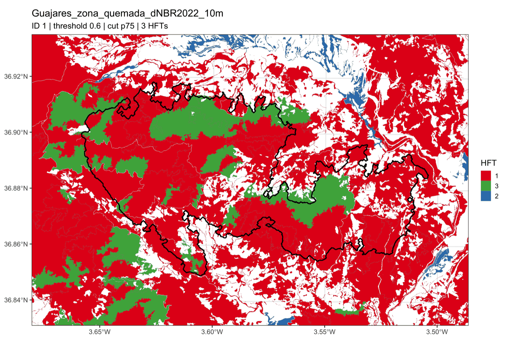
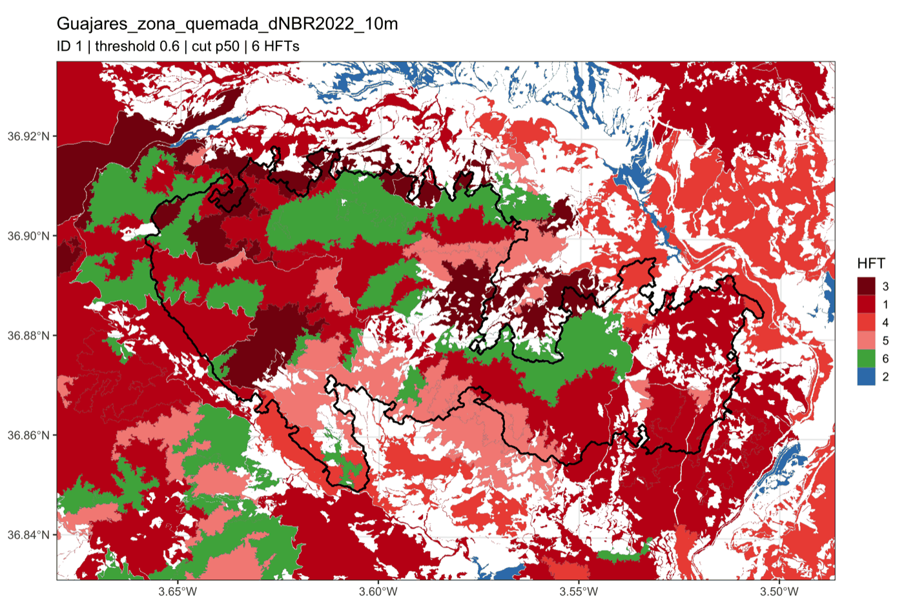
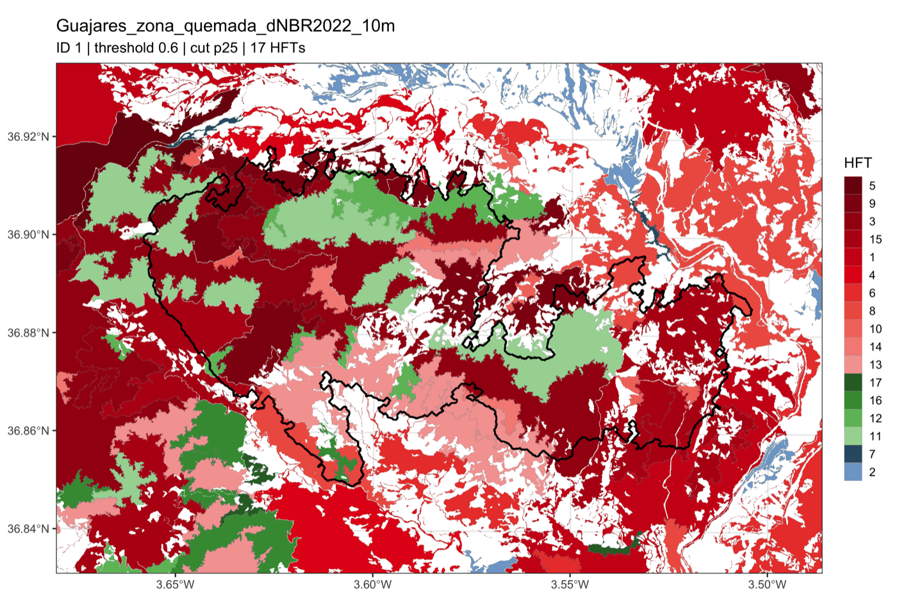
</p>

*HFT maps of the cuts `p75`, `p50` and `p25` (from broad to detailed): the
shades of each colour are the HFTs of the finer cuts inside an HFT of `p75`.*

### Threshold selection plot (`<id>_moran_var_mean.png`)

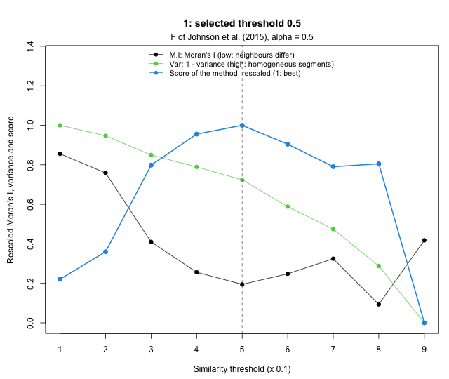

*This figure and the next one come from a run with `PA_BUFFER = 500` and the
default options (`THRESHOLD_METHOD = 'f'`, `CLASS_METHOD = 'ward_area'`); the
other figures of this section, from the run with `PA_BUFFER = 5000` and the
original methods (threshold 0.6).*

- **x axis**: threshold index `k` (1 to 9 for thresholds 0.1 to 0.9).
- **Black (M.I)**: Moran's I of the segment means, rescaled to 0-1 over the
  thresholds and averaged over the variables. High values: neighbouring
  segments are alike (the area is split more than needed).
- **Green (Var)**: area-weighted variance inside the segments, rescaled to 0-1
  and inverted, averaged over the variables. 1: the most homogeneous segments
  (lowest threshold), 0: the most heterogeneous ones (highest threshold).
- **Blue (Score)**: the score of `THRESHOLD_METHOD` for each threshold,
  rescaled so that the best one is 1 (not drawn with `'crossing'` or a fixed
  threshold).
- **Red points** (only with `'crossing'` and `'crossing_first'`): crossings of
  the black and green curves.
- **Dashed line**: the selected threshold. The subtitle names the method.

Low thresholds give many small, homogeneous segments (green near 1) that are
similar to their neighbours (black high). As the threshold grows, the segments
merge and become more heterogeneous (green goes down), while neighbouring
segments become more different (black goes down) until they are so large
that Moran's I grows again. The methods look for the best balance between
both (see [A5](#a5-optimal-segmentation-threshold)). In the example, `'f'`
selects 0.5 (144 segments): Moran's I has dropped to almost its lowest value
and the segments are still fairly homogeneous. At 0.9 (39 segments) Moran's I rises again, partly
because 23 of the segments have no neighbour (`MORAN_NEIGHBOURS`).

Check that the blue curve has a clear maximum. When two thresholds score
almost the same (0.4 and 0.5 here), either is defensible: compare them in the
next figure and look at their segmentations (`shp/park_segm_<id>_<k>.shp`) in
QGIS. To use another threshold, change `THRESHOLD_METHOD` (e.g. to `0.4`)
and run `python3 run_hft.py`.

### Threshold tables (`<id>_optim_thresholds.csv`, `overall_optim_thresholds.csv`)

- `<id>_optim_thresholds.csv` (a copy of `csv/<id>_threshold.csv`): one row
  per threshold with `threshold` (index `k`), `segments`, `isolated`
  (segments without neighbours for Moran's I), `moran` (mean of `|I|` over
  the variables), `var_rel` (variance inside the segments over the total
  variance of the pixels, mean over the variables), `moran_norm` and
  `var_norm` (the black and green curves), `score` (score of the method; `NA`
  with `'crossing'` or a fixed threshold) and `selected` (1 for the threshold
  used).
- `overall_optim_thresholds.csv`: one row per ID with the threshold used (e.g.
  `1 0.5`). The HFTs are the segments of this threshold.

### Variance explained by the HFTs (`r2_<id>_hfts.png`)

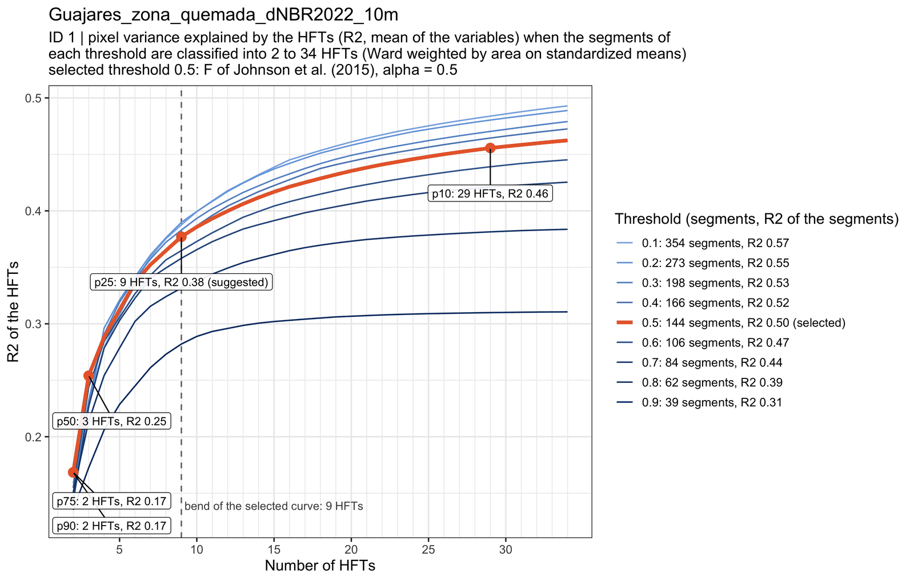

How much of the variation of the variables in the area the HFTs capture. For
each variable, R² is the part of the variance of its pixel values that lies
between the HFTs (the eta² of an analysis of variance with the HFT as factor,
the same eta2 as in the heatmap); the figure shows its mean over the
variables. 0: the HFTs do not differ at all; 1: every HFT is uniform.

- **Each line is a threshold**: its segments classified into 2, 3, ... HFTs
  with `CLASS_METHOD` (as in [A6](#a6-classification-of-the-segments-into-hfts)).
  Light blue: fine thresholds; dark blue: coarse ones; thick orange: the
  selected threshold.
- **Orange points**: the HFTs of the cuts of the selected threshold (`p10`,
  `p25`, `p50`, `p75` and `p90` with `SIMIL = 3`), with their number and R².
- **Legend**: number of segments of each threshold and R² of the segments
  themselves, the most the HFTs of that threshold could reach.
- **Dashed line**: the bend of the selected curve, and **(suggested)** next to
  the cut whose number of HFTs is closest to it.

R² always grows with the number of HFTs, so compare the thresholds at the
same number of HFTs (vertically). A curve below the others means that the
segments of that threshold mix different conditions and give worse HFTs. In
the example the thresholds 0.1 to 0.5 give about the same R² up to about 8
HFTs, the finest ones gain a little with more HFTs, and 0.6 to 0.9 give
clearly less.

**Suggested cut.** Along the selected curve, the number of HFTs where it bends
is the one beyond which each additional HFT adds little explained variance:
fewer HFTs lose much information, more HFTs make the classification more
complex for little gain. It is found with the Kneedle method (Satopää et al.,
2011) on the curve from 2 to 30 HFTs, as the point furthest above the straight
line between its ends once both axes are rescaled to 0-1:

```math
k^{*} = \arg\max_k \left( \frac{R^2_k - R^2_{2}}{R^2_{30} - R^2_{2}} - \frac{k - 2}{30 - 2} \right)
```

and the suggested cut is the one whose number of HFTs is closest to `k*` (in
logarithmic scale; with a tie, the one with fewer HFTs). Its files carry
`_optim` after the name of the cut (e.g. `p25/map_1_5_p25_optim_segms_hclust.png`),
the subtitle of its figures says "suggested", and it is printed, added to
`processing_metadata.txt` and marked in `r2_<id>_cuts.csv` (`suggested`).
In the example the curve bends at 9 HFTs and `p25` (9 HFTs) is suggested: it
keeps 75 % of the variance explained by the segments, against 51 % for `p50`
(3 HFTs) and 91 % for `p10` (29 HFTs). It is a suggestion: if you need broader
or more detailed HFTs, use another cut.

The values are modest (0.38 for the 9 HFTs of `p25`) because some variables
vary mostly between neighbouring pixels: in `r2_<id>_cuts.csv` the R² of
`p25` is 0.75 and 0.74 for temperature and precipitation, 0.28 to 0.38 for
the vegetation and water indices, and 0.11 and 0.02 for slope and TWI.

- `r2_<id>_hfts.csv`: one row per threshold and number of HFTs, with
  `threshold`, `segments`, `r2_segments`, `hfts`, `r2` (mean) and the R² of
  every variable.
- `r2_<id>_cuts.csv`: one row per cut of the selected threshold, with `cut`,
  `hfts`, `r2`, `r2_share` (its R² over the R² of the segments: the part of
  the information of the segments that the HFTs keep), `suggested` (1 for the
  suggested cut) and the R² of every variable.

They are computed from the pixel values of `../inVars` (skipped if the files
are not there), so they are exact with `STAT_AGG = 'mean'` and `'median'`
(see [A7](#a7-how-the-figures-are-computed)).

### Run metadata (`processing_metadata.txt`)

Date, study area, IDs processed, every option of `config.py`, the option
`upper` of `moranvar_plots.R` and, at the end, the suggested cut of every ID.
Keep it with the results to know how they were produced.

### Classification tree (`hclust_<id>_<k>_<cut>_segms_mean.png`)

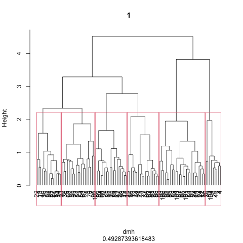

The dendrogram of the Ward classification of the segments of the selected
threshold (`CLASS_METHOD`, named under the plot). Each leaf is a segment
(numbered by its row in `csv/park_<id>_hri_results<k>.csv`), and the height
at which two branches join measures how different they are; with
`'ward_area'` it grows with the size of the groups, so the last joins are
much higher. The red boxes are the HFTs of this cut (with
`'ward_area_kmeans'`, before some segments move to the HFT of nearest mean).
With `SIMIL = 3` the tree is the same in the five folders and only the boxes
change: `p90` cuts it near the top (few broad HFTs), `p10` near the bottom
(many detailed HFTs).

The number under the plot is the **cophenetic correlation** between the
distances of the tree and the original distances between segments (their
Euclidean distances in the variables used to classify them): the closer
to 1, the better the tree keeps them. Ward trees usually give moderate values
(0.49 in the example), since they favour compact groups over keeping every
distance.

Use it to choose the cut: long branches just above a cut mean clearly
separated HFTs; HFTs that join just above the cut are similar and could be
taken together.

### HFT map (`map_<id>_<k>_<cut>_segms_hclust.png`)


The segments coloured by HFT, with the outline of the study area in black and
the borders of the segments in thin grey. White areas inside the map are
pixels without data in the first variable (e.g. water, urban areas, crops), or
outside the variables. The map covers the bounding box of the ID grown by
`PA_BUFFER`. A segment can be made of several close patches (fragments
merged with `SMALL_SEGM_RADIUS`).

### HFT polygons (`park_segm_<id>_<k>_<cut>_class.shp`)

The same map as a shapefile, in the CRS of the variables, with one feature per
segment and these fields:

| Field | Content |
|---|---|
| `hclst_m` | HFT of the segment in this cut. |
| `segm_id` | Segment ID: area ID, threshold index and a 5-digit segment number (`1600001`: area 1, threshold 0.6, segment 1). |
| `cat`, `label` | Segment number and (empty) label of the GRASS vector. |
| `cat_pa`, `wdpaid` | Area ID. |
| one field per variable | Relative profile of the HFT (the values of the radar plot, 0-1). The names are shortened to 10 characters by the shapefile format, in the order of `ENV_VARS` (e.g. `G_1_NDV`). |

To use it in QGIS: *Symbology → Categorized* on `hclst_m`. The area of each
HFT is in the legend of the boxplots and of the NMDS (or with the field
calculator, `$area / 10000` for hectares, and *Statistics by categories*). The
shapefile can be used to stratify field sampling by HFT, to report the
habitat composition of the study area, or to compare the HFTs with other maps
(vegetation, land cover, fire severity, ...).

### Radar plot (`radarplot_<id>_<k>_<cut>_segms_mean.png`)

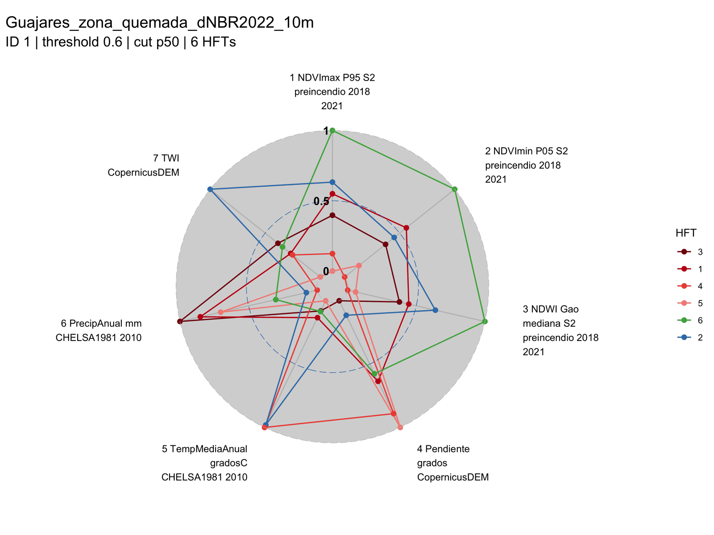

One line per HFT and one axis per variable. The value of an HFT on an axis is
the mean of the segment means (or medians with `STAT_AGG = 'median'`) of its
segments, rescaled between the HFTs: **0 is the HFT with the lowest value of
that variable and 1 the HFT with the highest**. It shows at a glance which
variables set each HFT apart. In the example the green HFT (6) has the
highest NDVI and NDWI, the blue one (2) and HFT 4 the highest temperature,
and the dark red ones (3 and 1) the highest precipitation.

The scale is relative and is stretched from 0 to 1 even when the HFTs hardly
differ in a variable: in the example slope and TWI show a wide spread on the
radar but explain little of the differences between HFTs (eta2 of 0.03 and
0.01 in the heatmap). Check the boxplots or the heatmap before interpreting
an axis.

### Boxplots of the pixel values (`boxplot_<id>_<k>_<cut>_hft_pixels.png`)

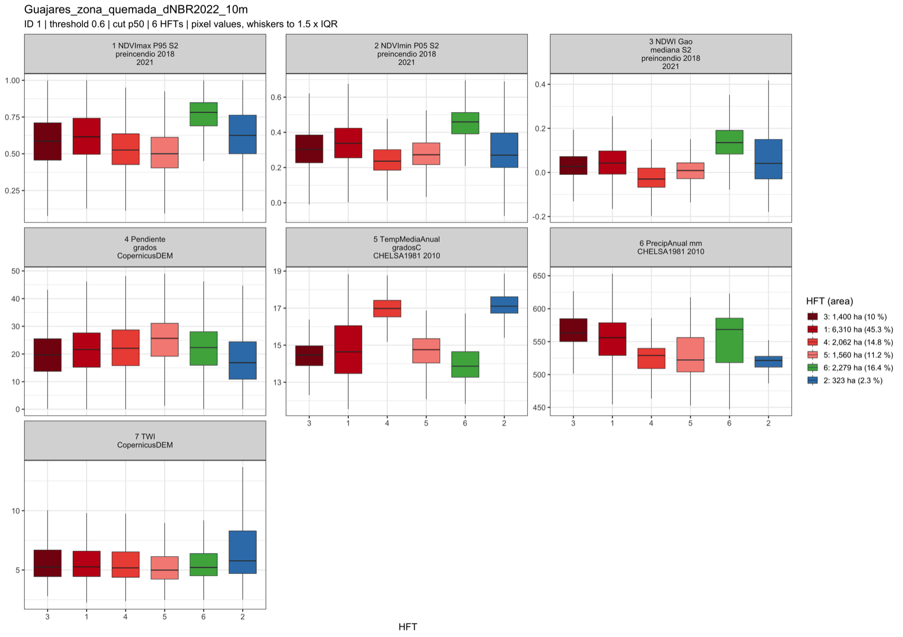

One panel per variable, in its original units and with its own scale, and one
box per HFT made of all its pixels (read from `../inVars`): the line is the
median, the box goes from the first to the third quartile and the whiskers to
1.5 times the interquartile range (extreme pixels are not drawn). The legend
gives the area of each HFT in hectares and in % of the classified area.

Boxes that do not overlap mean that the variable separates those HFTs; boxes
at the same height mean that it does not. Use them to describe the HFTs in
real units: in the example HFTs 2 and 4 are the warmest (medians of 17.1 and
17.0 °C) and among the driest (521 and 529 mm), while slope varies much more
inside each HFT than between them.

### Heatmap of the HFT profiles (`heatmap_<id>_<k>_<cut>_hft_profiles.png`)

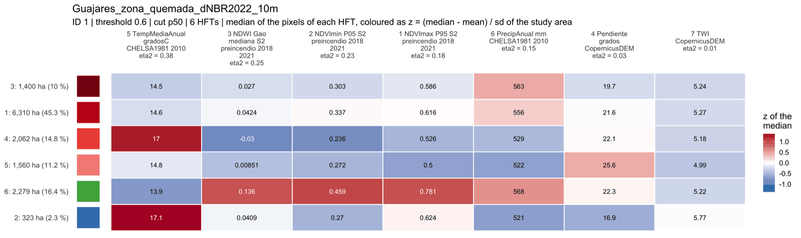

A table with one row per HFT (in the order of the tree, with its colour and
area on the left) and one column per variable:

- **the number** in each cell is the median of the pixels of the HFT, in the
  original units of the variable;
- **the colour** is how far that median is from the mean of the classified
  area, in standard deviations: `z = (median - mean) / sd`. Red: above the
  mean, blue: below, white: close to it;
- **eta2**, under each variable name, is the share of the variance of the
  variable (over all the pixels) explained by the HFTs, from 0 (the HFTs do
  not differ in it) to 1 (all of its variation is between HFTs). The columns
  are ordered from the highest to the lowest eta2.

This is the best plot to **name the HFTs**: read each row from left to right,
keeping in mind that the variables on the left matter most. In the example
temperature (eta2 = 0.38) and the vegetation indices (0.18 to 0.25) separate
the HFTs, while slope (0.03) and TWI (0.01) hardly do; HFT 6 (16.4 % of the
area) is greener and wetter than the mean (NDVI max 0.78, NDWI 0.136) and HFT
4 (14.8 %) warmer and drier (17.0 °C, 529 mm).

### PCA biplot of the HFTs (`pca_biplot_<id>_<k>_<cut>_hft.png`)

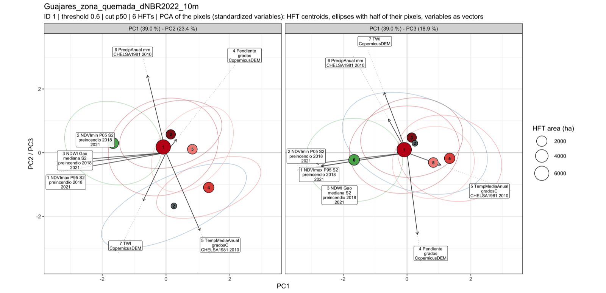

A principal component analysis of the standardised pixel values of all the
classified pixels, in two panels: PC1-PC2 and PC1-PC3. The percentage of the
variance explained by each component is in the panel titles (39.0, 23.4 and
18.9 % in the example).

- **Circles**: the centroid of the pixels of each HFT, sized by its area.
- **Ellipses** (with 10 HFTs or fewer): the region that holds about half of
  the pixels of each HFT. Their overlap shows how much the HFTs mix at the
  pixel level; HFTs are made of segments, so some overlap is expected.
- **Arrows**: the variables. Their direction is that of the increase of the
  variable and their length its correlation with the components; arrows
  pointing the same way are correlated variables. An HFT lying in the
  direction of an arrow has high values of that variable.

In the example the three vegetation indices point together along PC1 (they
carry the same information), with the green HFT on their side, and
temperature points towards HFTs 4 and 2.

### NMDS of the segments (`NMDS_<id>_<k>_<cut>_segms_mean.png`)

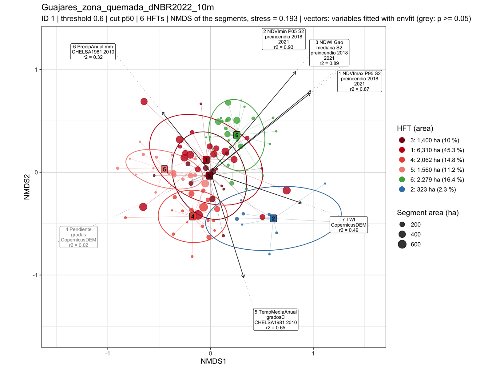

A non-metric multidimensional scaling of the segments using the distances
between them that the classification uses (standardised means with
`'ward_area'`; means and variances rescaled to 0-1 with `'ward'`), so it
shows how the classification sees the segments.

- **Points**: segments, coloured by HFT and sized by area, joined by a thin
  line to the centroid of their HFT (labelled box).
- **Ellipses** (with 10 HFTs or fewer, for HFTs with 4 segments or more):
  about 68 % of the segments of each HFT.
- **Arrows**: the variables (segment means) fitted to the ordination with
  `vegan::envfit`: the direction in which each variable increases, with a
  length proportional to its correlation with the ordination; `r2` in the
  label is the share of the variable explained by the two axes. Grey arrows
  and labels are not significant (p >= 0.05, 999 permutations).
- **Stress** (in the subtitle): how well the two axes keep the distances
  between segments. As a rule of thumb, below 0.1 is good, 0.1 to 0.2 is
  usable and above 0.2 should be read with care (0.193 in the example).

Well separated groups of points mean distinct HFTs; segments far from their
centroid or among the points of another HFT are transitional. In the example
the vegetation indices (r2 = 0.87 to 0.93) organise the segments, and slope
(r2 = 0.02) is not significant.

### Putting it together

A practical order to read the results of one ID:

1. `<id>_moran_var_mean.png`: is the selected threshold sensible? Look at the
   segmentation of that threshold (`shp/park_segm_<id>_<k>.shp`) in QGIS.
2. `r2_<id>_hfts.png`: do the HFTs of the selected threshold capture as much
   of the variance as those of other thresholds with the same number of HFTs?
3. `hclust_...png` and the maps of the five cuts: which level of detail suits
   your purpose (`p90` and `p75` broad, `p50` intermediate, `p25` and `p10`
   detailed)? The suggested cut, the R² of each cut and where the curve
   bends help to decide.
4. For the chosen cut, the heatmap and the boxplots: name each HFT by the
   variables that set it apart (high eta2, colours far from white).
5. The PCA biplot and the NMDS: are the HFTs distinct, or do some of them
   overlap so much that they could be merged (a coarser cut)?
6. Use `park_segm_<id>_<k>_<cut>_class.shp` for the maps and analyses that
   follow.

## Annex: how the HFT model works

This annex documents what each script computes, step by step, with the
parameters that are fixed in the code.

### A1. Workflow diagram

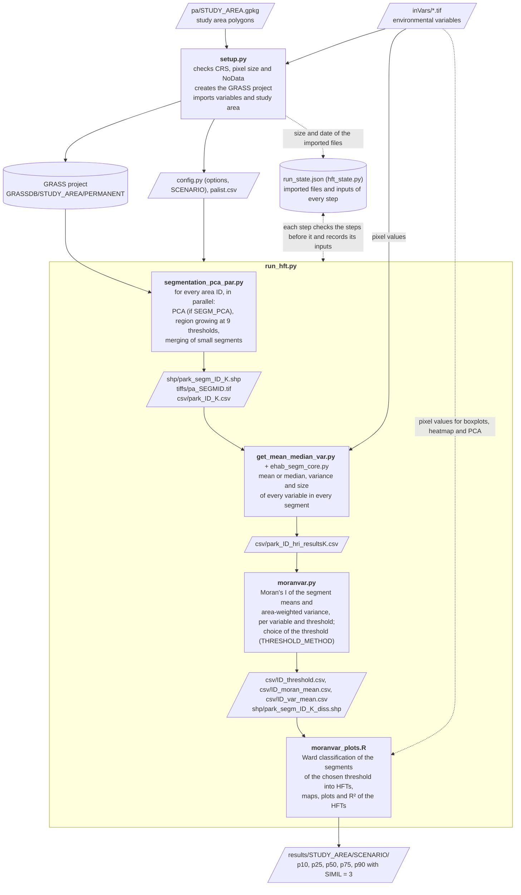

`run_hft.py` first shows the scenario (and lets you change it), then runs
`segmentation_pca_par.py`, `get_mean_median_var.py` and `moranvar.py` (or only
`moranvar_plots.R`) in this order, starting from the first one that is out of
date according to `run_state.json` (A11), and runs `setup.py` first when an
input file changed. The scripts can also be run one by one: each one checks in
`run_state.json` that the steps before it are up to date.

### A2. Setup (setup.py)

1. Lists `../inVars/*.tif` (and `.tiff`) and, for each one, reads its CRS,
   pixel size and NoData value with GDAL (first band). It stops if two files
   give the same map name, if a file has no CRS or a geographic one, if the
   CRS differ (compared with `IsSame`, ignoring the axis order) or if the
   pixels are not square or not of the same size.
2. Finds the study area file in `pa/` (or `--study-area`) and its layer.
3. Creates the GRASS project with `grass -c <first variable> -e
   GRASSDB/<study area>`, so it takes the CRS of the variables. If the project
   exists, checks that its CRS is that of the variables.
4. Imports the variables with `r.import` and the study area with `v.import`
   (which reprojects it to the CRS of the project) into `PERMANENT`: those not
   in the project yet, those whose file changed (size or modification time)
   since `setup.py` imported it, or all of them with `--overwrite`.
5. Reads the integer IDs of `COL_ID` and writes them to `palist.csv`.
6. Writes the options to `config.py` with regular expressions that replace
   only the value of each option (the comments are kept).
7. Records its options and the size and modification time of every file in
   `run_state.json` (see [A11](#a11-run-record-hft_statepy-and-run_hftpy)).

### A3. Segmentation (segmentation_pca_par.py)

`segmentation_pca_par.py` first checks the GRASS project and the record of the
previous run ([A11](#a11-run-record-hft_statepy-and-run_hftpy)): it resumes an
interrupted run with the same inputs, does nothing if the last run finished
with the same inputs, and otherwise (or with `FORCE_RESTART`) empties `csv`,
`shp` and `tiffs` and starts from scratch. Then it sends the IDs
of `palist.csv` to a pool of `EHAB_NPROC` workers. Each worker processes one
ID at a time in its own GRASS mapset (`m1`, `m2`, ...):

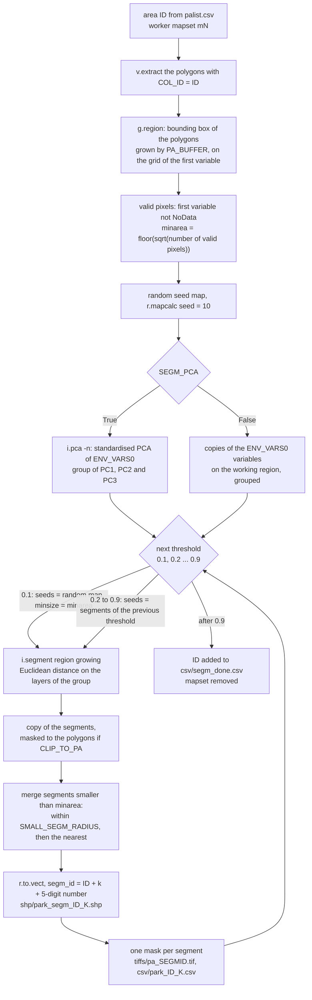

1. **Working region.** `v.extract` takes the polygons whose `COL_ID` is the
   ID, and `g.region vector=... grow=... align=<first variable>` sets the
   region to their bounding box grown by `PA_BUFFER` (`grow` counts pixels, so
   `PA_BUFFER` is divided by `RESOLUTION` and rounded up), with its edges moved
   outwards to the pixel edges of the first variable and its pixel size. All
   the maps of this ID are computed on this grid, which is that of the
   variables, so no pixel is resampled or shifted.
2. **Valid pixels and minimum size.** `const = if(isnull(first variable),
   null(), 1)` marks the pixels with data in the first variable of `ENV_VARS0`.
   With `N` the number of valid pixels, the minimum size of a segment is

   ```math
   \text{minarea} = \left\lfloor \sqrt{N} \right\rfloor \ \text{pixels}
   ```

   (1180 pixels, 11.8 ha, for the 1.39 million valid pixels of the Guajares
   example).
3. **Seeds.** A random map (`rand()` with `seed=10`, saved as
   `tiffs/rndseed_<id>.tif`) is the starting seeds of the first segmentation.
   Being fixed, it keeps the results consistent between runs and GRASS
   versions.
4. **PCA.** `i.pca -n` computes the principal components of the variables of
   `ENV_VARS0`, each one centred and scaled to unit variance, so that no
   variable dominates because of its units. The first three components
   (`pax_<id>.1`, `.2`, `.3`), which usually hold most of the variance of
   correlated environmental variables, are grouped for the segmentation.
   With `SEGM_PCA = False` there is no PCA: each variable of `ENV_VARS0` is
   copied to the working region (`pax_<id>_1`, `_2`, ...) and all of them are
   grouped. The copies are needed because `i.segment` scales every layer of
   the group to the range of the whole map, which for the copies is the
   range in the working region, as for the components; with the maps of
   `PERMANENT` it would be the range of the whole raster.
5. **Region growing at nine thresholds.** `i.segment` (`method=region_growing`,
   `similarity=euclidean`, `iterations=20`, `memory=10000`) merges
   neighbouring segments that are each other's most similar neighbour while
   the Euclidean distance between their values (PC1-PC3, or the variables
   with `SEGM_PCA = False`), each layer scaled to 0-1 with its minimum and
   maximum, is below the threshold (0: only identical pixels merge, 1:
   everything merges). It runs for the thresholds 0.1 to 0.9:
   - at 0.1 it starts from the seed map and segments smaller than `minarea`
     are merged into their most similar neighbour (`minsize=minarea`);
   - from 0.2 on it starts from the segments of the previous threshold
     (`seeds`), so segments only grow: the nine segmentations are nested, from
     fine (0.1) to coarse (0.9).
6. **Clip (optional).** With `CLIP_TO_PA = True` a mask of the polygons of the
   ID is set while copying the segments, so only the pixels inside them are
   kept.
7. **Merging of small segments.** Region growing leaves small segments, above
   all fragments isolated by NoData pixels. On the copy of the segments of
   each threshold (the next threshold still starts from the unmerged
   segments), `merge_small_segments()` works in memory with NumPy and SciPy:
   1. for every segment with fewer than `minarea` pixels, it looks at the
      pixels within `SMALL_SEGM_RADIUS` pixels (Euclidean distance between
      pixel centres) around it, keeps those of larger segments (or of the same
      size and a larger number, so two segments never swap) and joins the most
      frequent of them;
   2. it applies all the joins (following chains: if `a` joins `b` and `b`
      joins `c`, `a` ends in `c`) and repeats until nothing changes, so groups
      of nearby fragments end up in one segment;
   3. the small segments still left (no larger segment within the radius)
      join the segment with `minarea` pixels or more that is nearest to any of
      their pixels, at any distance.

   No segment smaller than `minarea` is left, and a segment can be made of
   several close patches.
8. **Vectors and IDs.** `r.to.vect -v` turns the segments into polygons, and
   each segment gets as `segm_id` the text `<area ID><k><segment number with 5
   digits>` (`1600001` is area 1, `k = 6`, segment 1), which is unique between
   areas and thresholds and the same on every run. The segmentation is
   exported as `shp/park_segm_<id>_<k>.shp`.
9. **Masks.** For every segment, the region is set to its bounding box
   (aligned with the grid of the first variable), the polygon is rasterised
   (1 inside, 0 outside) and saved as
   `tiffs/pa_<segm_id>.tif`. Its `segm_id` is written to
   `csv/park_<id>_<k>.csv` and `k` to `csv/ecoregs<k>.csv` (the lists read by
   the next step).

### A4. Statistics of the segments

`get_mean_median_var.py` chooses the statistic (`STAT_AGG`) and calls
`ehab_segm_core.py`, which, for every ID of `csv/segm_done.csv` and every
threshold `k`, reads the segments of `csv/park_<id>_<k>.csv`. For each
segment `s`:

1. reads its mask `tiffs/pa_<segm_id>.tif` and, for every variable of
   `ENV_VARS`, the window of `../inVars/<file>` under it (the offset, a whole
   number of pixels because the mask is on the grid of the variables, is
   computed from the origins of both rasters and `RESOLUTION`), keeping the
   `n_s` pixels inside the segment;
2. turns the NoData values into gaps and fills them by linear interpolation
   between the pixels before and after them (in row order). A variable without
   any data in the segment is written as `None`;
3. computes, in double precision and without rounding, the statistic (mean or
   median) `m_s`, the population variance `σ²_s` and `σ²_s · n_s`.

The results are written to `csv/park_<id>_hri_results<k>.csv` (replacing the
files of a previous run of the ID):

| Column | Content |
|---|---|
| `ecoregion` | Threshold index `k`. |
| `segm_id` | Segment ID. |
| `<variable>pamean` | Mean or median of the variable in the segment (`m_s`). |
| `<variable>pavar` | Variance of the variable in the segment (`σ²_s`). |
| `sumpamask` | Number of pixels of the segment (`n_s`). |
| `<variable>pavar2` | `σ²_s · n_s`, to weight the variances by area. |

### A5. Optimal segmentation threshold

The threshold is chosen with the idea of Espindola et al. (2006): a good
segmentation has segments that are internally homogeneous (low variance
inside them) and different from their neighbours (low spatial autocorrelation
between them). Low thresholds give homogeneous segments that resemble their
neighbours; high thresholds give segments that differ from their neighbours
but are heterogeneous inside. `moranvar.py` measures both for the nine
segmentations of every ID and chooses one with `THRESHOLD_METHOD`.

#### Measures of every threshold

For every variable `v` and threshold `k`:

1. **Neighbours.** The polygons of `shp/park_segm_<id>_<k>.shp` are dissolved
   by `segm_id` (one multipolygon per segment, saved as `..._diss.shp`). Two
   segments are neighbours if they share an edge (`MORAN_NEIGHBOURS = 'rook'`,
   `libpysal.weights.Rook`) or, with `'queen'`, also if they only touch at a
   corner (`libpysal.weights.Queen`), with row-standardised weights `w_ij`.
   A segment without neighbours counts in `n` and in the denominator of
   Moran's I but not in its numerator; their number is the column `isolated`
   of `csv/<id>_threshold.csv`.
2. **Moran's I** of the segment means `x_s` of the variable (`esda.Moran`),
   taken in absolute value:

   ```math
   I_{v,k} = \frac{n}{\sum_i \sum_j w_{ij}} \;
             \frac{\sum_i \sum_j w_{ij}\,(x_i-\bar{x})(x_j-\bar{x})}{\sum_i (x_i-\bar{x})^2}
   ```

3. **Area-weighted variance** inside the segments (`n_s` pixels):

   ```math
   V_{v,k} = \frac{\sum_s n_s\,\sigma^2_{s,v}}{\sum_s n_s}
   ```

4. **Total variance of the pixels**, the variance inside the segments plus
   the variance between their means (exact with `STAT_AGG = 'mean'`; with
   `'median'` the medians are used instead of the means):

   ```math
   V^{tot}_{v,k} = V_{v,k} + \frac{\sum_s n_s\,(x_s - \bar{x})^2}{\sum_s n_s},
   \qquad \bar{x} = \frac{\sum_s n_s\,x_s}{\sum_s n_s}
   ```

5. **Rescaling over the thresholds** (0 if all thresholds give the same
   value), so that both measures are comparable and between 0 and 1:

   ```math
   MI_{v,k} = \frac{|I_{v,k}| - \min_k |I_{v,k}|}{\max_k |I_{v,k}| - \min_k |I_{v,k}|}
   \qquad
   VAR_{v,k} = \frac{\max_k V_{v,k} - V_{v,k}}{\max_k V_{v,k} - \min_k V_{v,k}}
   ```

   `MI` is 1 at the threshold with the most similar neighbours and `VAR` is 1
   at the threshold with the most homogeneous segments. They are saved per
   variable (one row per variable) in `csv/<id>_moran_segm.csv`,
   `csv/<id>_var_segm.csv` and, their mean, `csv/<id>_movar_segmsum.csv`.
6. **Mean over the variables** (`n_v` variables, ignoring those without
   data), saved in `csv/<id>_moran_mean.csv`, `csv/<id>_var_mean.csv` and
   `csv/<id>_movar_results.csv` (`Aver`, kept for reference):

   ```math
   MI_k = \frac{1}{n_v}\sum_v MI_{v,k}, \qquad
   VAR_k = \frac{1}{n_v}\sum_v VAR_{v,k}, \qquad
   Aver_k = \frac{MI_k + VAR_k}{2}
   ```

Every variable weighs the same in the scores below, whatever its units.

#### Methods (`THRESHOLD_METHOD`)

**`'f'` (default): F-function of Johnson et al. (2015).** The same function
as `optimization_function=f` of the GRASS addon `i.segment.uspo`. With
`H_k = 1 - MI_k` (1: the neighbours differ the most) and `α =
THRESHOLD_ALPHA`, the threshold with the highest

```math
F_k = (1 + \alpha^2)\,\frac{VAR_k\,H_k}{\alpha^2\,H_k + VAR_k}
```

is chosen. `F` is a weighted harmonic mean of the homogeneity of the segments
and of their difference from their neighbours: it is high only when both are
high, so it penalises the thresholds that are good in one sense only (`F = 0`
at the highest threshold, where `VAR = 0`). `α` sets the weight of `VAR`
against `H`: with `α = 1` both weigh the same; as `α` grows `F` tends to
`VAR` and favours homogeneous segments (lower thresholds); as it decreases
`F` tends to `H` and favours segments that differ from their neighbours
(higher thresholds). The default `α = 0.5` comes from the test below.

**`'gs'`: Global Score of Espindola et al. (2006).** The same as
`optimization_function=sum` of `i.segment.uspo`: the threshold with the
lowest

```math
GS_k = (1 - VAR_k) + MI_k
```

The classical method, useful to compare with other studies. Being a sum,
a threshold can win with a very good value of one measure and a poor one of
the other.

**`'gs_fixed'`: Global Score with fixed bounds.** The threshold with the
lowest

```math
GS^{fix}_k = \frac{1}{n_v}\sum_v \left( \frac{V_{v,k}}{V^{tot}_{v,k}} + |I_{v,k}| \right)
```

The rescaling of `MI` and `VAR` uses the lowest and highest values of the
thresholds tested, so the score of a threshold, and sometimes the threshold
chosen, change when other thresholds are added or removed (Böck et al.,
2017). Here both terms have fixed bounds instead: `V / V^tot` goes from 0
(every pixel its own segment) to 1 (a single segment) and is `1 - R²` of the
segments, and `|I|` is at most about 1. The scores are then comparable between
IDs and study areas. Its weakness is the other side of the same coin: the two
terms can span very different ranges, and then one of them decides
(Georganos et al., 2018); in Guajares `V / V^tot` went from 0.43 to 0.69 and
`|I|` from 0.26 to 0.48.

**`'crossing'`: first crossing of the curves minus one threshold (the
original method of eHabitat+), and `'crossing_first'`: the first crossing.**
Where `MI_k - VAR_k` changes sign between two consecutive thresholds `a` and
`b`, the crossing is interpolated linearly:

```math
x = a + \frac{VAR_a - MI_a}{(MI_b - MI_a) - (VAR_b - VAR_a)}\,(b - a)
```

and, from the first crossing `x_1`, the threshold index is

```math
k^* = \mathrm{round}(x_1) - 1 \quad (\texttt{'crossing'}), \qquad
k^* = \mathrm{round}(x_1) \quad (\texttt{'crossing\_first'})
```

(0.5 if the curves do not cross). Use it to reproduce results of earlier
versions. Two properties make it less reliable than the others: the crossing
is where `MI_k + (1 - VAR_k) = 1`, not where that sum (the Global Score) is
lowest; and, since `VAR` is 1 at the lowest threshold tested and 0 at the
highest, the curves almost always cross near the end, so the threshold
chosen tends to follow the highest threshold tested (in Guajares it chose 0.7
when testing 0.1 to 0.9, 0.6 with 0.1 to 0.8 and 0.5 with 0.1 to 0.7).

**A number (e.g. `0.5`): a fixed threshold**, to impose one or to compare
scenarios with the same threshold.

With all the methods the evaluated threshold closest to the result is used,
and ties go to the lowest threshold. `csv/<id>_threshold.csv` keeps the
scores of every threshold and the one chosen (copied to
`<id>_optim_thresholds.csv` with the results).

#### Test with the Guajares data

The methods were compared on ID 1 of the Guajares example (`PA_BUFFER = 500`,
7 variables): with the thresholds 0.1 to 0.9, with four shorter ranges
(0.1-0.8, 0.2-0.9, 0.1-0.7 and 0.3-0.9), leaving out each variable in turn,
and with other neighbours for Moran's I. Then the segments of 0.4, 0.5 and
0.7 were classified into HFTs (with `CLASS_METHOD = 'ward'`) and compared
with the R² of
[`r2_<id>_hfts.png`](#variance-explained-by-the-hfts-r2_id_hftspng).

| `THRESHOLD_METHOD` | 0.1 to 0.9 | Other ranges | Without one variable | `'queen'` | 4 nearest segments |
|---|---|---|---|---|---|
| `'f'`, `α = 0.5` | **0.5** | 0.5 | 0.5 | 0.6 | 0.6 |
| `'f'`, `α = 1` | 0.4 | 0.4-0.5 | 0.4-0.5 | 0.6 | 0.6 |
| `'f'`, `α = 2` | 0.3 | 0.3-0.4 | 0.3-0.4 | 0.5 | 0.4 |
| `'gs'` | 0.4 | 0.4-0.5 | 0.4-0.5 | 0.6 | 0.4 |
| `'gs_fixed'` | 0.5 | 0.5 | 0.4-0.5 | 0.6 | 0.5 |
| `'crossing'` | 0.7 | 0.5-0.7 | 0.7 | 0.8 | 0.7 |
| `'crossing_first'` | 0.8 | 0.6-0.8 | 0.8 | 0.9 | 0.8 |

- `'f'` with `α = 0.5` chose the same threshold in all the ranges and without
  any of the variables; `'gs_fixed'` almost always. Both chose 0.5.
- With the same number of HFTs, the HFTs of 0.1 to 0.5 explain about the
  same variance up to about 10 HFTs, and those of 0.6 to 0.9 clearly less
  (see the figure of `r2_<id>_hfts.png`). 0.5 is the coarsest threshold
  that keeps the R² of the finer ones, from 144 segments instead of 354 at
  0.1. The HFT maps of 0.4 and 0.7 had little in common (adjusted Rand index
  0.13 for `p50`), so the choice matters.
- The crossing methods chose 0.7-0.8, at the coarse end, and moved with the
  highest threshold tested.
- With `'queen'`, Moran's I keeps decreasing up to 0.9 instead of rising at
  the end, and all the methods but the crossing ones chose 0.5-0.6.

This is one study area: check `<id>_moran_var_mean.png` and
`r2_<id>_hfts.png` with your data. `'gs_fixed'` is a good alternative when
the scores have to be compared between IDs, `'gs'` to compare with other
studies that use the Global Score, and a fixed threshold to compare scenarios.

The GRASS addon `i.segment.uspo` computes `'gs'` and `'f'` itself, running
`i.segment` for every threshold. It is not used here because it measures the
raw output of `i.segment` (before the merging of small segments and
`CLIP_TO_PA`) on the layers of the segmentation (PC1 to PC3) and averages
their variances before rescaling, so the layer with the largest variance
decides; here the same functions are applied to the final segments and to
every variable rescaled on its own.

### A6. Classification of the segments into HFTs

`moranvar_plots.R` reads `csv/park_<id>_hri_results<k*>.csv` and groups the
segments of the selected threshold into HFTs with Ward's hierarchical
clustering (Ward, 1963). `CLASS_METHOD` sets how the segments are described
and weighted; the tree is then cut with `SIMIL`.

#### Methods (`CLASS_METHOD`)

**`'ward_area'` (default): Ward weighted by area on standardised means.**
Each segment `s` is described by its statistic `m_{s,v}` (mean or median,
`STAT_AGG`) of every variable, standardised with the standard deviation
`σ_v` of the pixels of the ID (from the variance inside and between the
segments, as `V^tot` in A5):

```math
z_{s,v} = \frac{m_{s,v} - \bar m_v}{\sigma_v}, \qquad
\bar m_v = \frac{\sum_s n_s\,m_{s,v}}{\sum_s n_s}
```

A variable constant in the whole area gets `z = 0` and does not count; a
segment without data in a variable gets the mean of the variable. The
segments are then joined with Ward's criterion weighting each one by its
number of pixels `n_s`: at every step the two groups `A` and `B` whose union
least increases the sum of squares of the pixels within the groups,

```math
\Delta(A, B) = \frac{N_A\,N_B}{N_A + N_B}\,\lVert \bar{\mathbf z}_A - \bar{\mathbf z}_B \rVert^2
```

are joined (`N`: number of pixels; `z̄`: means weighted by area). This is
`hclust(..., "ward.D2", members = n_s)` on the Ward distances
`sqrt(2 Δ)` between segments, which gives the same tree as Ward's method on
all the pixels, starting from the segments as groups. So the HFTs keep the
variance of the pixels within them as low as possible (the R² of
`r2_<id>_hfts.png` as high as possible), every variable weighs the same (in
units of its standard deviation), and a large segment weighs more than a
small fragment.

**`'ward_area_kmeans'`: the same, then weighted k-means.** After each cut,
every segment moves to the HFT with the nearest mean, and the means
(weighted by area) are computed again, until no segment moves: k-means
weighted by area starting from the HFTs of the tree, a usual way to
consolidate a Ward classification. It can only lower the variance within the
HFTs of that cut, but the HFTs of different cuts are no longer exactly nested:
their colours and order follow the tree, and the boxes of the dendrogram show
the HFTs before the consolidation. An HFT can be left without segments and
disappear.

**`'ward'`: the original method of eHabitat+.** Each segment is described by
the statistic and the variance of every variable, each one rescaled to 0-1
over the segments of the ID:

```math
\mathbf{f}_s = \left(\tilde m_{s,1}, \dots, \tilde m_{s,n_v},\ \tilde\sigma^2_{s,1}, \dots, \tilde\sigma^2_{s,n_v}\right),
\qquad
\tilde y_s = \frac{y_s - \min_t y_t}{\max_t y_t - \min_t y_t}
```

so the segments are compared by both their typical conditions and their
internal heterogeneity. The Euclidean distances between the vectors
(`vegan::vegdist`) are joined with Ward's criterion without weights
(`hclust(..., "ward.D2")`): every segment counts the same, whatever its size.

The **cophenetic correlation** of the tree, shown in the dendrogram plot, is
computed against the Euclidean distances between the segments in the
variables of the method (`z` or `f`), which are also those of the NMDS.

#### Test with the Guajares data

The methods were compared with the segments of the thresholds 0.3, 0.4, 0.5
and 0.7 of the Guajares example (`PA_BUFFER = 500`), cut into 2 to 20 HFTs,
together with `'ward'` on the means only (without the variances; not an
option). The separability of the HFTs was measured with the pixels of
`../inVars`, standardised:

- **R²**: part of the variance of the pixels between the HFTs, mean over the
  variables (as in `r2_<id>_hfts.png`).
- **Jeffries-Matusita distance (JM)** between every pair of HFTs, the usual
  measure of class separability in remote sensing (Bruzzone et al., 1995).
  With `μ` and `Σ` the mean vector and the covariance matrix of the pixels of
  each HFT:

  ```math
  B = \frac{1}{8}(\boldsymbol\mu_a - \boldsymbol\mu_b)^T \Sigma^{-1} (\boldsymbol\mu_a - \boldsymbol\mu_b)
      + \frac{1}{2}\ln\frac{|\Sigma|}{\sqrt{|\Sigma_a|\,|\Sigma_b|}},
  \qquad \Sigma = \frac{\Sigma_a + \Sigma_b}{2},
  \qquad JM = 2\,(1 - e^{-B})
  ```

  from 0 (same distribution of the pixels) to 2 (completely separable). Its
  mean over all the pairs and its minimum (the least separable pair).
- **Silhouette width** (Rousseeuw, 1987) of every segment on the
  standardised means (how much closer it is to its HFT than to the next one,
  from -1 to 1), averaged weighting by area.

With the threshold 0.5 and 8 HFTs (the cut `p50` of `'ward'`):

| `CLASS_METHOD` | R² | Mean JM | Minimum JM | Silhouette |
|---|---|---|---|---|
| `'ward'` | 0.31 | 1.35 | 0.30 | 0.11 |
| `'ward'` on the means only | 0.34 | 1.30 | 0.63 | 0.19 |
| `'ward_area'` | 0.37 | 1.61 | 0.78 | 0.21 |
| `'ward_area_kmeans'` | 0.37 | 1.61 | 0.66 | 0.24 |

- Over the four thresholds and 2 to 20 HFTs, `'ward_area'` gave a higher R²
  and silhouette than `'ward'` in all the cases, a higher mean JM in 84 % of
  them and a higher minimum JM (a single pair, more variable) in 61 %.
- Most of the gain comes from leaving the variances out: they grow with the
  size of the segment (Spearman correlation with its number of pixels 0.64
  for temperature and 0.59 for precipitation), so they group the segments
  partly by their size. Weighting by area and standardising add the rest.
- With `'ward_area'`, the 9 HFTs of `p25` explain as much variance (R² 0.38)
  as the 19 HFTs of `p25` of `'ward'`.
- The maps change: the adjusted Rand index between the HFTs of `'ward'` and
  `'ward_area_kmeans'` with 8 HFTs was 0.41.
- `'ward_area_kmeans'` improves the silhouette a little more, but not the JM.

The R² and the silhouette are measured on the means, which favours the
methods that classify by them; the JM distance also accounts for the spread
of the pixels within each HFT, and favours `'ward_area'` too. Even so the
HFTs overlap (mean JM about 1.6, the least separable pair about 0.7): the
environmental gradients are continuous. Not tested: mixtures of normal
distributions (model-based clustering), fuzzy clustering, and Ward with
spatial constraints (ClustGeo; Chavent et al., 2018), which gives more
compact HFTs but, by construction, less separable ones.

#### Cut of the tree and colours

1. **Cut of the tree** (`SIMIL`), with `h_max` the height of the last merge
   (with `'ward_area'` the heights grow with the size of the groups, so the
   same fractions give fewer HFTs than with `'ward'`):
   - `SIMIL = 3`: cuts at heights `0.10 h_max`, `0.25 h_max`, `0.50 h_max`,
     `0.75 h_max` and `0.90 h_max` (`p10`, `p25`, `p50`, `p75`, `p90`), with
     no limit on the number of HFTs;
   - `SIMIL = 1`: cut at the first quartile of the merging heights;
   - `SIMIL = 2`: cut below the lowest merge (every segment apart), so the
     number of HFTs is set by the limits below.

   With `SIMIL` 1 and 2 the number of HFTs is then limited, cutting the tree
   into fewer groups, to

   ```math
   n_{HFT} \le \left\lceil \log_6 N \right\rceil \ (\text{upper} = 2)
   \ \text{or}\ \left\lceil \log_{10} N \right\rceil \ (\text{upper} = 1),
   \qquad n_{HFT} \le n_v - 1
   ```

   with `N` the number of pixels analysed. If a cut gives a single HFT, every
   segment is taken as its own HFT. The figures are drawn when there are at
   least two HFTs.
2. **Colours.** Without `SIMIL = 3`, the Set1 palette (interpolated beyond 8
   HFTs). With `SIMIL = 3`, `hier_colours()` gives colours that follow the
   hierarchy of the cuts, as the "tree colors" of Tennekes & de Jonge (2014)
   in the HCL colour space. The cuts with more than one HFT are taken from the
   broadest to the finest (identical cuts once):
   - the HFTs of the broadest cut share out the circle of hues (0-360°), each
     one a part proportional to the number of HFTs of the finest cut it
     contains, in the order of the dendrogram, keeping 75 % of its part and
     leaving the rest as gaps between families;
   - every HFT of the next cut gets, in the same way, a part of the range of
     the HFT that contains it (here without gaps), and so on down to the
     finest cut;
   - the colour of an HFT is `hcl(h, 80, L)`, with `h` the centre of its range
     (plus 15°), chroma 80 and luminance `L` 60 in the broadest cut and, in
     the others, alternately 47 and 69 between neighbouring HFTs of a family;
     an HFT that does not change from one cut to the next keeps its colour.

   These values were chosen with a palette validator (lightness band, chroma,
   and colour difference between neighbouring colours of the legend for normal
   vision and colour blindness): in the example, the palettes of up to about
   10 HFTs pass every check except the contrast of the lightest colours with
   a white background.

### A7. How the figures are computed

- **Threshold plot**: `MI_k`, `VAR_k` and the score of the method of A5
  (rescaled to 0-1, 1 at the best threshold), or the crossings with
  `'crossing'` and `'crossing_first'`.
- **R² of the HFTs** (`r2_<id>_hfts.png`): the segments of every threshold
  are rasterised on the grid of the first variable and, for every segment
  `s` and variable `v`, the number of pixels `n_s`, the sum `S_s` and the sum
  of squares `Q_s` of the pixel values (centred on their mean) are added up.
  The segments of the threshold are classified with `CLASS_METHOD` (A6) into
  2, 3, ... HFTs and, for
  every partition, with `N_h` and `S_h` the sums over the segments of HFT `h`
  and `N`, `S`, `Q` over all of them:

  ```math
  R^2_v = \frac{\sum_h S_h^2 / N_h - S^2 / N}{Q - S^2 / N}
  ```

  which is the `eta²` of the heatmap; the figure shows its mean over the
  variables. The R² of the segments (each segment its own HFT) is the
  highest that the HFTs of a threshold can reach. Being computed from the
  pixels, it does not depend on `STAT_AGG`. The dashed line is the bend of
  the selected curve (Kneedle) and the suggested cut the closest to it (see
  [Variance explained by the HFTs](#variance-explained-by-the-hfts-r2_id_hftspng)).
- **Dendrogram**: the tree of A6 with `rect.hclust()` boxes for the HFTs of
  the cut; the subtitle is the cophenetic correlation.
- **Map and shapefile**: `shp/park_segm_<id>_<k*>_diss.shp` joined with the
  HFT of every segment and with the radar profile of its HFT, drawn with
  `ggplot2::geom_sf` with the study area (`pa/`, reprojected if needed) on
  top.
- **Radar**: for every HFT `h` and variable `v`, the mean of `m_{s,v}` over
  its segments (not weighted by area), rescaled to 0-1 over the HFTs.
- **Pixels of each HFT** (boxplots, heatmap, PCA): the variables are read
  from `../inVars` with `terra` (resampled with nearest neighbour to the grid
  of the first variable when needed; NoData removed), the HFT shapefile is
  rasterised on that grid, and the area of each pixel comes from
  `terra::cellSize` (hectares).
- **Boxplots**: quartiles of the pixels of every HFT, whiskers to the most
  extreme pixel within 1.5 times the interquartile range.
- **Heatmap**: with `x̄_v` and `s_v` the mean and standard deviation of all
  the classified pixels, `n_h` and `x̄_{h,v}` the number of pixels and the
  mean of HFT `h`:

  ```math
  z_{h,v} = \frac{\mathrm{median}_h(x_v) - \bar x_v}{s_v},
  \qquad
  \eta^2_v = \frac{\sum_h n_h\,(\bar x_{h,v} - \bar x_v)^2}{\sum_i (x_{i,v} - \bar x_v)^2}
  ```

- **PCA biplot**: eigen-decomposition of the correlation matrix of the
  standardised pixels (complete cases). The centroids are the mean scores of
  the pixels of every HFT, the ellipses those of a bivariate normal with the
  mean and covariance of these scores at the 50 % level (radius
  `sqrt(qchisq(0.5, 2))`), and the arrows the loadings (eigenvectors times the
  square root of the eigenvalues, i.e. the correlations between variables and
  components), all scaled together to the size of the plot.
- **NMDS**: `vegan::metaMDS` (2 dimensions, `set.seed(1)`) on the distances
  between the segments of the classification (A6); centroids are the mean position of the
  segments of every HFT and ellipses normal at the 68 % level
  (`stat_ellipse`); vectors from `vegan::envfit` of the segment means with
  999 permutations (`set.seed(1)`), drawn with length `sqrt(r2)`.

### A8. Intermediate files

| File | Written by | Content |
|---|---|---|
| `csv/study_area.csv` | segmentation | Study area of the files in `csv`, `shp` and `tiffs`. |
| `csv/segm_done.csv` | segmentation | IDs whose segmentation finished. |
| `csv/park_<id>_<k>.csv` | segmentation | `segm_id` of every segment of threshold `k`. |
| `csv/ecoregs<k>.csv` | segmentation | `k` once per segment: list of thresholds read by the statistics step. |
| `shp/park_segm_<id>_<k>.shp` | segmentation | Segments of threshold `k` (`cat`, `cat_pa`, `segm_id`). |
| `tiffs/pa_<segm_id>.tif` | segmentation | Mask of every segment (1 inside, 0 outside). |
| `tiffs/rndseed_<id>.tif` | segmentation | Seed map of the first segmentation. |
| `csv/park_<id>_hri_results<k>.csv` | statistics | Statistics of every segment (A4). |
| `csv/ecoregs_done<k>.csv` | statistics | Log of the thresholds processed. |
| `shp/park_segm_<id>_<k>_diss.shp` | moranvar.py | Segments dissolved by `segm_id`. |
| `csv/<id>_movar_thresholds.csv` | moranvar.py | Threshold, number of segments and of pixels (one row per threshold). |
| `csv/<id>_threshold.csv` | moranvar.py | Measures and score of every threshold and the one chosen (A5), read by `moranvar_plots.R`. |
| `csv/<id>_moran_segm.csv`, `_var_segm.csv`, `_movar_segmsum.csv` | moranvar.py | `MI`, `VAR` and their mean per variable (rows) and threshold (columns). |
| `csv/<id>_moran_mean.csv`, `_var_mean.csv`, `_movar_results.csv` | moranvar.py | `MI_k`, `VAR_k` and `Aver_k` per threshold. |

`csv`, `shp` and `tiffs` only hold the last study area processed (they are
emptied when the segmentation starts from scratch). `run_state.json` (in
`segm_optim`) is the record of A11.

### A9. Reproducibility

- The seed map of the segmentation (`seed=10`), the `segm_id` of the
  segments, `metaMDS` and `envfit` (`set.seed(1)`) are the same on every run,
  so the same inputs give the same results.
- `processing_metadata.txt` records the options of every run, and
  `run_state.json` the inputs of every step.

### A10. Fixed parameters and limitations

- The nine thresholds (0.1 to 0.9), the three principal components (with
  `SEGM_PCA = True`) and the `i.segment` parameters (`region_growing`,
  `euclidean`, 20 iterations, 10000 MB of memory) are fixed in
  `segmentation_pca_par.py`; `upper` is set in
  `moranvar_plots.R`.
- With `SEGM_PCA = True` at least three variables are needed (three
  principal components); with `SEGM_PCA = False` one is enough.
- The CRS must be projected (`setup.py` stops with a geographic CRS), in
  metres.
- The parallelism is over the IDs: one ID uses one core.
- The boxplots, heatmap and PCA biplot read the whole rasters of `../inVars`
  into memory.
- A change to `palist.csv` (e.g. one more ID) repeats the segmentation of
  every ID, not only of the new one.
- Changes to the input files are detected by their size and modification
  time, not by their content: copying a file again with a new date counts as
  a change.

### A11. Run record (hft_state.py and run_hft.py)

`hft_state.py` keeps `run_state.json`, with:

- for every study area, what `setup.py` imported: its options and the size
  and modification time of every file of `../inVars` and of the study area
  file;
- for every step (segmentation, statistics, Moran's I, variance and threshold,
  HFTs and plots), the inputs it was run with (the table of step 6:
  options of `config.py`, `palist.csv`, input files and a hash of its own
  code), a hash of those inputs together with the inputs of all the steps
  before it, and whether it finished;
- for every study area and scenario, the inputs of all the steps that
  produced its results (written when the last step finishes), which
  `run_hft.py` compares with the current ones to warn when a scenario name is
  used again with other options.

A step is up to date when it finished and that hash is the same as the one
computed now. When a script starts, it checks that every step before it is up
to date (else it stops and says which one to run and why), records that it is
running and, at the end, that it finished; `moranvar_plots.R` does the same
through `python3 hft_state.py check|start|done plots`. Since the hash of a
step includes the inputs of the steps before it, a change that makes a step
out of date makes all the steps after it out of date too. `run_hft.py` reads
the same record to run the
first step that is out of date and all the steps after it, and
`python3 hft_state.py` alone prints the status of every step.

### References

- Böck, S., Immitzer, M., & Atzberger, C. (2017). On the objectivity of the
  objective function: problems with unsupervised segmentation evaluation
  based on Global Score and a possible remedy. *Remote Sensing*, 9(8), 769.
  https://doi.org/10.3390/rs9080769
- Bruzzone, L., Roli, F., & Serpico, S. B. (1995). An extension of the
  Jeffreys-Matusita distance to multiclass cases for feature selection. *IEEE
  Transactions on Geoscience and Remote Sensing*, 33(6), 1318-1321.
  https://doi.org/10.1109/36.477187
- Chavent, M., Kuentz-Simonet, V., Labenne, A., & Saracco, J. (2018).
  ClustGeo: an R package for hierarchical clustering with spatial
  constraints. *Computational Statistics*, 33(4), 1799-1822.
  https://doi.org/10.1007/s00180-018-0791-1
- Espindola, G. M., Câmara, G., Reis, I. A., Bins, L. S., & Monteiro, A. M.
  (2006). Parameter selection for region-growing image segmentation
  algorithms using spatial autocorrelation. *International Journal of Remote
  Sensing*, 27(14), 3035-3040.
- Georganos, S., Lennert, M., Grippa, T., Vanhuysse, S., Johnson, B., &
  Wolff, E. (2018). Normalization in unsupervised segmentation parameter
  optimization: a solution based on local regression trend analysis.
  *Remote Sensing*, 10(2), 222. https://doi.org/10.3390/rs10020222
- Johnson, B. A., Bragais, M., Endo, I., Magcale-Macandog, D. B., &
  Macandog, P. B. M. (2015). Image segmentation parameter optimization
  considering within- and between-segment heterogeneity at multiple scale
  levels: test case for mapping residential areas using Landsat imagery.
  *ISPRS International Journal of Geo-Information*, 4(4), 2292-2305.
  https://doi.org/10.3390/ijgi4042292
- Murtagh, F., & Legendre, P. (2014). Ward's hierarchical agglomerative
  clustering method: which algorithms implement Ward's criterion? *Journal of
  Classification*, 31, 274-295.
- Rousseeuw, P. J. (1987). Silhouettes: a graphical aid to the
  interpretation and validation of cluster analysis. *Journal of
  Computational and Applied Mathematics*, 20, 53-65.
  https://doi.org/10.1016/0377-0427(87)90125-7
- Satopää, V., Albrecht, J., Irwin, D., & Raghavan, B. (2011). Finding a
  "Kneedle" in a haystack: detecting knee points in system behavior. *31st
  International Conference on Distributed Computing Systems Workshops*,
  166-171. https://doi.org/10.1109/ICDCSW.2011.20
- Tennekes, M., & de Jonge, E. (2014). Tree colors: color schemes for
  tree-structured data. *IEEE Transactions on Visualization and Computer
  Graphics*, 20(12), 2072-2081. https://doi.org/10.1109/TVCG.2014.2346277
- Ward, J. H. (1963). Hierarchical grouping to optimize an objective
  function. *Journal of the American Statistical Association*, 58(301),
  236-244. https://doi.org/10.1080/01621459.1963.10500845
